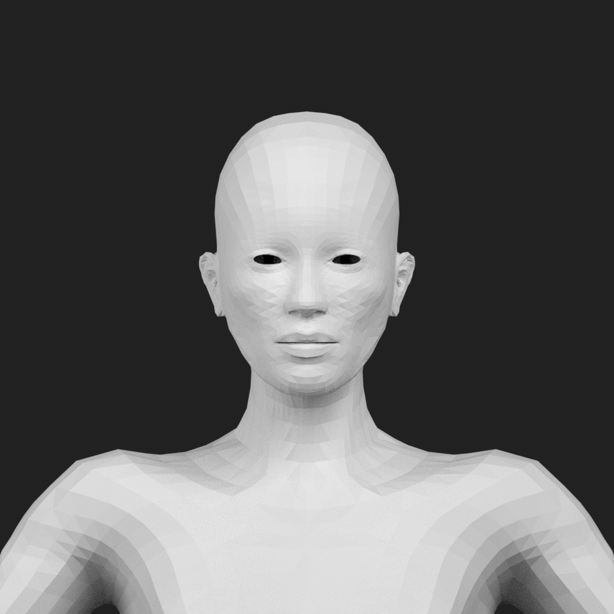
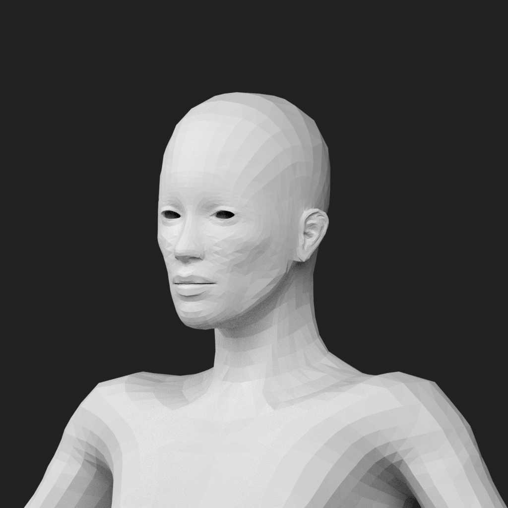
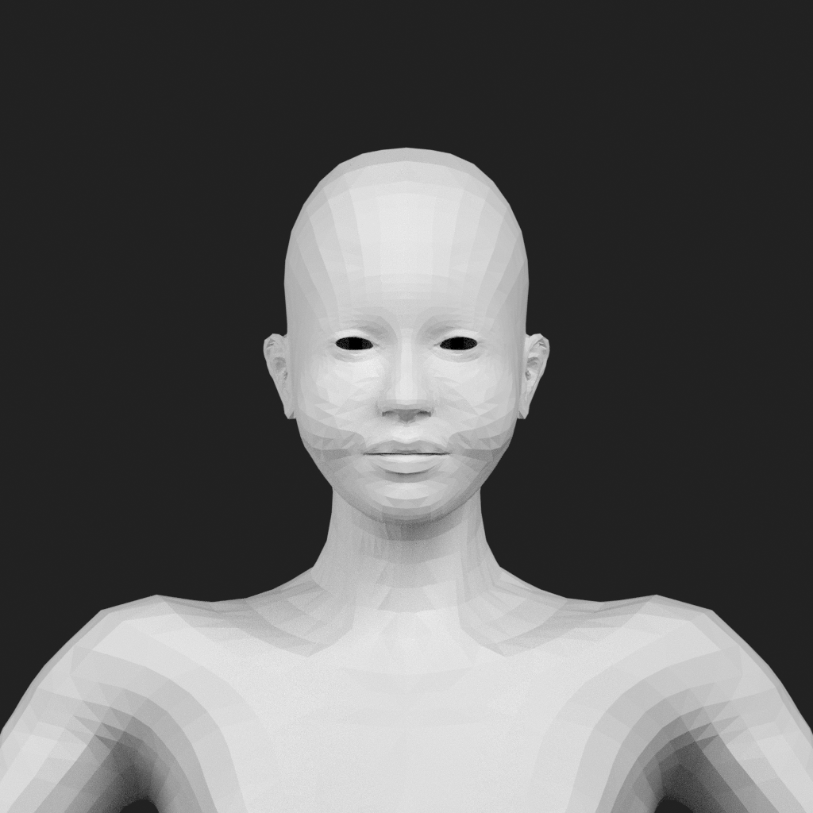
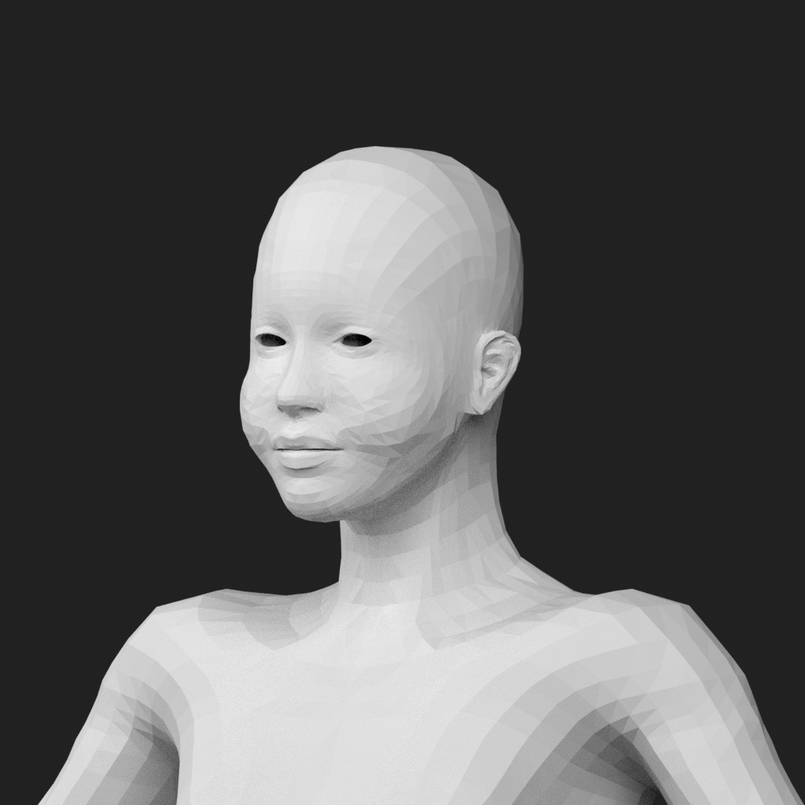

# Cheek-fullness source reference — issue #134

2026-11-03. **Reference useful; product acceptance is not established here.**

This is an independent Blender source-delta comparison on the approved raw neutral MakeHuman base. It is neither an MPFB native-operation equivalence claim nor a Nvwa runtime image. The actual inputs are the four pinned MPFB 2.0.18 cheek-volume targets from commit `d0a32e57a7f915cb2f2b95410e2117648c7bbb7e`. Both sides use the full authored weight. The positive endpoint is not the negative endpoint multiplied by -1.

An independent Astra reviewer first viewed all six images without the value mapping, wrote and froze the visual findings, and only then opened the mapping and receipts. The blind fullness ranking was A > B > C in both views, strongest at 35 degrees. The revealed mapping was +1 > 0 > -1. The supported meaning is rounder/full versus leaner/hollow cheeks, including adjacent cheek planes; it is not pure jaw width or a promise of unchanged lip/nose geometry. No new obvious facial distortion was found in these two views.

| State | Front | 35 degrees |
| --- | --- | --- |
| 0, neutral |  |  |
| -1, authored decrease |  |  |
| +1, authored increase |  |  |

All states use the same base, neutral rest, preserved ordered vertices/faces, camera, material, lighting, seed and exposure. The first six renders under the initial recipe were saturated and are retained privately as a failed presentation. One technical repair used only the neutral front's raw-linear fixed-region p99 to select a common exposure; no endpoint image was used to tune it. The first neutral render was reused as the repaired baseline rather than adding a diagnostic capture. There were twelve unique formal renders in total, not an open-ended search.

Blender was 5.2.2 LTS, build `d13f752e3b9c`. The original and repaired runs took 82.157 and 92.986 seconds. The source has 19,158 vertices and 18,486 ordered faces; states 0/-1/+1 move 0/304/420 vertices. Input identities and full bilateral sums passed the pre-render checks; maximum Blender float32 component difference was `2.98e-8`. These are reference calculations, not a replacement for existing runtime numeric gates.

The common stored exposure is `-2.277625560760498`, selected by `min(0, log2(0.8/q))`, where neutral-only linear q was `3.8790340423583984`. The fixed region had zero any-channel-255 pixels in each repaired image. Baseline/front was saved from a retained linear EXR via `Image.save_render`; the other five used render `write_still`. Fixed-region differences attributable to this output path were at most 1/255; no global bound or pixel equality is claimed. The reviewer found that this limit did not explain the broad local shape differences, including the angle views that share one save path.

Exact PNG hashes, state mapping, blind-record digest and run IDs are in [RESULTS.json](RESULTS.json). The [source analysis and original reference design](../../research/jaw-cheek-control/source-data-and-reference.md) record provenance, units, proxy-region limits and the fixed scene. The new delivery Goal authorized this actual reference and its one common presentation repair after the original design-only stage.

**PARTIAL — This permits proceeding under the user's existing conditional implementation authorization. Anatomical non-target preservation, textured attachment fit, action playback, actual Nvwa rendering, AI authoring, Web/CLI exchange and release verification still need their own evidence. #133's original failure and all other quality HOLDs remain.**
