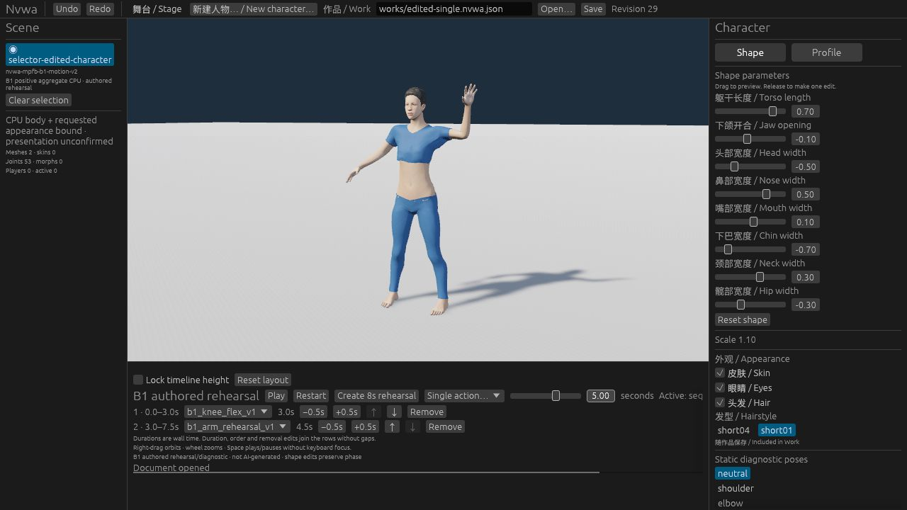

# B1 authored motion authoring — 2026-10-29

Implementation + actual Web/CLI acceptance complete; publication receipt tracked
by [#124](https://github.com/Derek-X-Wang/nvwa/issues/124). This record fixes the
compiled implementation source at `30aa99e5bba3fef82ba4d533ce8a6ee01586a17b`,
tree `eebeb66c2c5fcfd9b473ed5f738f6a5d347dc38b`. The later documentation commit
does not identify a different compiled runtime. Publication and formal CI/main
receipts belong to #124, not to a future commit or CI snapshot embedded here.



## What passed

The stock Web app at 1280×720 opened an already edited eight-parameter B1 Work
with short01, Skin/Eyes/Hair, scale1.1 and a custom stage. Actual **Create 8s
rehearsal** created arm0–4s → knee4–8s. Row duration, order and action edits,
Undo/Redo and restore passed. Repeating Create on the identical timeline kept
revision24 and Redo; Redo then restored the prior duration edit. Actual Play,
Pause, exact4s seek, finite8s completion and Replay passed. The completed default
sequence is visible in [09-finite-complete.jpg](screenshots/09-finite-complete.jpg).

Normal Web Save downloaded revision28. The freshly built CLI inspected it,
discovered its capabilities, validated its assets, applied the retained
[command](works/cli-edit-command.json), then validated, saved and validated
revision29. Normal Web Open and its file chooser loaded that actual saved file.
A second normal Save downloaded the **byte-identical complete document**:
SHA-256 `1ea35aaa987db55eaa9cccaa15d964b8b7f32a2308c4367dbd3740d46e47c0a0`.
Only timeline and revision changed; character identity, all eight parameters,
profile, appearance, scale and stage stayed intact. The actual reopened
knee3s → arm4.5s sequence showed the arm pose at5s and completed at7.5s; see
[13-cli-finite-complete.jpg](screenshots/13-cli-finite-complete.jpg).

| Exact retained Work | Meaning |
| --- | --- |
| [edited-single](works/edited-single.nvwa.json) | revision21 starting Work; one arm loop |
| [browser-download](works/browser-download.nvwa.json) | revision28 normal Web Save; finite arm4s → knee4s |
| [cli-saved](works/cli-saved.nvwa.json) | revision29 CLI edit/save; finite knee3s → arm4.5s |
| [web-reopened-readback](works/web-reopened-readback.nvwa.json) | revision29 normal Web Open/Save; exact CLI bytes |

The [acceptance record](acceptance.json) contains the action ledger, commands,
artifact identities and limits without private host paths. The
[evidence manifest](evidence-manifest.json) authenticates the curated exact
Works, command and screenshots. The browser warning/error query returned no
entries. Web Open retains the prior download-name field; file content proves
the loaded Work's identity independently of that field.

## Separate checks and artifacts

| Evidence | Result |
| --- | --- |
| Native workspace tests and check | PASS240 tests, including77 Studio tests; `check.sh native` |
| Experiment73 source admission | PASS56 normal +56 optimized; all old context pins, fixtures, assertions and3/4-map matrices retained; new5-map matrix admits5 and rejects110,587 |
| Complete portable catalog | PASS16 groups in839s (13m59s), unchanged20min maximum |
| Wasm check | PASS; `check.sh wasm` |
| Fresh CLI build | PASS; `cargo build -p nvwa-cli --locked --offline` |
| Fresh Web export | PASS; `bash scripts/build-web.sh dev`, wasm-bindgen0.2.129 |
| Actual Web/CLI acceptance | PASS normal controls, download, CLI edit/save, file chooser and byte-identical readback |

CLI SHA-256: `3bdc412f87122aa92bc0507c091335d1e2d2db7eccf87312a48facfae36b4459`.
Exported Wasm SHA-256: `bd209275a1c4620a400ff00ceba896b03f288fd84f8be01f2b9d8d7de229ee56`.
The Web build receipt authenticates272 source entries; its SHA-256 is
`954838271ef923835d1656a4dd4f52a22bfbf295c96943711b6222d3b6b557d7`.
Native/Wasm compilation, actual Web behavior and historical retained-evidence
controls are separate observations.

To inspect the exchange from the repository root with a locally built CLI:

```sh
target/debug/nvwa-cli inspect docs/evidence/b1-motion-authoring/works/browser-download.nvwa.json
target/debug/nvwa-cli describe-capabilities docs/evidence/b1-motion-authoring/works/browser-download.nvwa.json
target/debug/nvwa-cli validate docs/evidence/b1-motion-authoring/works/cli-saved.nvwa.json assets
```

Use normal Web Open to select the retained CLI Work. Playback cursor and Undo
history are session state. Start a new command with the file's actual revision;
the retained command specifically expects revision28.

## Limits retained

Ordinary desktop GUI acceptance is **NOT-RUN**, deferred by the
[verification policy](../../agents/verification.md). No AI model ran; these are
authored presets. No GPU numerical readback, performance result or character/
clothing quality clearance is claimed. #120, M2, #80 and full #79 appearance/
contact quality remain **HOLD**; #112's original failure, #3's blocked
reproduction and #4's measurement gaps remain. The failed child-session browser
discovery is a retained tooling limit; root-controlled actual QA supplied the
product evidence. Original GLB9s and static B1 capability boundaries stay intact.
