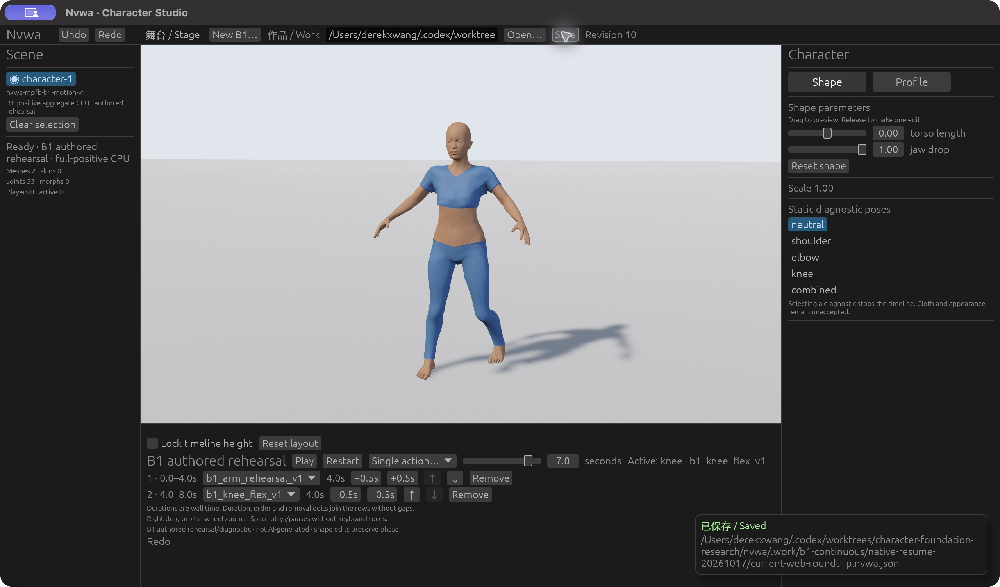
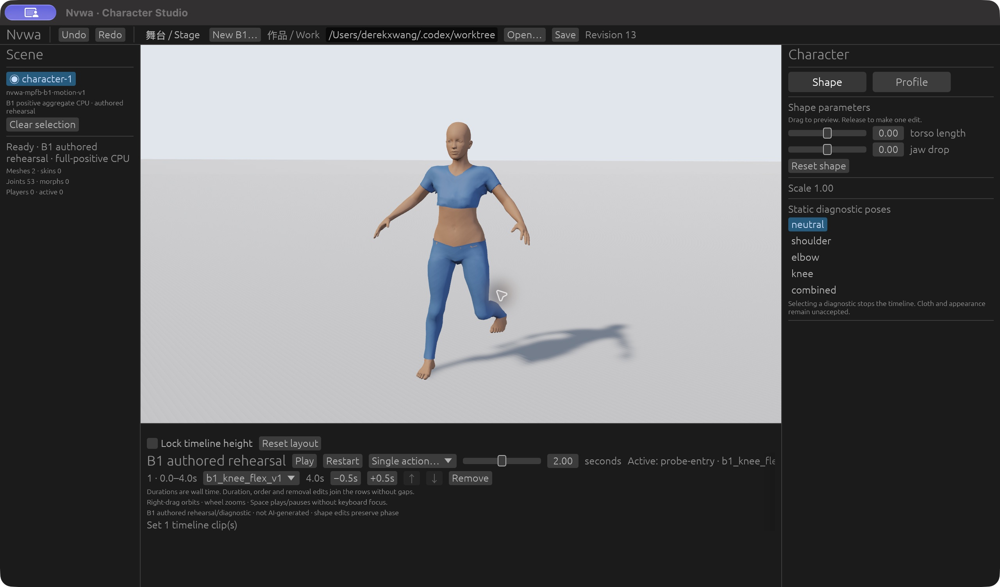

# 当前修正版 B1：原生补验与作品交换

2026-10-17，用户确认解锁后执行。测试的是当前修正版r4，不是旧r2。普通应用、加性读回窗口和Player串行运行，只有根负责人操作图形界面。产品代码、依赖、角色资产和数值阈值均未更改。

## 普通界面与新保存文件

- 普通原生Studio打开现行Web保存的rev7（torso0.75/jaw1、八秒两段）。实际Play前进到4.459秒屈膝；可见滑条定位7秒。暂停修改torso0，Undo回0.75、Redo回0，revision8/9/10均保留7秒和动作姿势。
- 正常Save写出rev10、torso0/jaw1与完整两条时间线，并出现右下角“已保存 / Saved”及文件位置。新文件SHA256为 `5ea189bd5fa884aeddbfbd4ceac9172f462729229a18ab0913a8cfb68dcca14b`。见 [gui-saved.nvwa.json](gui-saved.nvwa.json)。现行CLI的validate/inspect实际执行成功；不是重跑此前21条命令。
- Restart后手臂实际运动，Pause停在2.158秒。仅把本轮专用保存副本临时改成缺失值JSON，再用正常Open得到真实解析错误；人物、revision10和2.158秒姿势保留。恢复副本原字节并正常Open后，回0暂停、两条时间线与参数完整、错误清除。输入/历史证据原件未改。
- 普通Web产品的正常文件选择器Open这个新原生Save文件：rev10、torso0/jaw1、完整两段、0秒暂停。Restart实际前进到0.2016秒，后续到8秒中立完成、Replay可用。本轮没有新的Web Save/download；交换链是现行Web rev7→当前原生Open/edit/Save rev10→当前Web正常Open rev10，并由当前原生正常重开同一个Save文件。
- 正常原生Player使用相同rev10，左右编辑面板隐藏；Restart/Pause停在手臂2.258秒，滑条定位6.2秒屈膝，再Play到8秒中立完成并显示Replay。没有用探针窗口替代普通产品。



## 三种躯干与实际同帧数据

原生探针仍调用正常 `nvwa_studio::build_app()`。新目录、新request ID取得15份完整实际读回：本轮rev10打开状态，加上冻结合同的14个组合。中立躯干两动作各0/1/2/3/4秒，短/长躯干各两个动作的2秒峰值，jaw0。没有重跑594矩阵。

六张峰值图覆盖短/中/长躯干×手臂/屈膝。[visual-bindings.json](visual-bindings.json)将截图对应到实际读回的request、时刻、revision/generation与哈希。人物、衣物、支撑脚/抬脚与地面实际可见；毫米脚高仍来自几何，不能从图片推定。

[geometry-correspondence.json](geometry-correspondence.json)逐项对照14份新读回与先前同字节r4、已独立检查的14帧：全部53骨骼数据、映射/权重及两网格的positions/normals/tangents/indices/rest/display transform精确相同，未加容差。只排除每次运行分配的 `display_entity`/`mesh_handle`；新旧revision/generation/serial及实体身份分别保留。旧数据匹配公开captured-samples及保留的现行r4数值证据。根负责人另行重复全部14组比较。

这是新窗口与既有独立FK/LBS/脚部证据的数据对应，**没有声称本轮重新运行FK/LBS/表面检查或GPU顶点读回**。193源码、125产物重新哈希均未变。普通原生：`3c142ca7b95245151d0804761d437517b938461912b08e63f81211fc97c48ecb`；探针：`97847e93992b57ea183f7f7fc3f4b804321c73317dd489ecbdb70bbc2a1101fd`；普通Web Wasm：`b0e22cf9ae5959304f072dfc8f197f53b421b8cfcdbaee4cf5b91c6614501c9d`。



## 失败、保留边界与复现

数字时间输入的批量按键、分开输入和重新取焦点/粘贴未确认生效；停止键盘重试后使用实际滑条定位7秒。保留03/04截图，文件名不代表六秒通过；不据此宣称产品键盘错误或键盘验收通过。

私有捕获驱动首次读取JSON null状态发生AttributeError。初始请求实际已落地；匹配captured状态与唯一文件后未重发，只给驱动加dict判断，后续1–14依次完成。见 [capture-driver-startup-failure.json](capture-driver-startup-failure.json)。产品源码/超时未改，旧黑图与r2失败证据保留。

肩、腋、腰/腿折叠与穿插仍可见，#80衣物质量HOLD不变。只覆盖当前角色、两个明确预制动作及声明体型；不是AI生成、任意动作自然度、通用碰撞/布料物理/IK或高质量外观准入。#3阻塞、#4性能缺口、M2质量HOLD，以及近loop精确导数/重复seek/双形变组件故障族等既有未验证项保留。

26张原始CUA图及事件见 [normal-observations.json](normal-observations.json)。[capture-manifest.json](capture-manifest.json)记录15份完整JSON的身份、字节和哈希；137,324,764字节原始数据保留在此worktree `.work/b1-continuous/native-resume-20261017/probe/captures/`，不提交大网格JSON。使用 [实验60](../../../../experiments/60-b1-continuous-motion/README.md)同一构建与新输出目录/request ID复现。普通应用需先复制作品，操作真实控件：

```sh
nvwa_native_work="$(mktemp -d)/roundtrip.nvwa.json"
cp docs/evidence/b1-motion/native-resume-20261017/gui-saved.nvwa.json "$nvwa_native_work"
target/debug/nvwa-studio --work "$nvwa_native_work"
# 关闭Studio后串行检查Player：
target/debug/nvwa-studio --player --work "$nvwa_native_work"
```

三个任务窗口均关闭并确认进程退出；临时IAB页8关闭，9278服务停止且无监听。保留worktree、构建与完整数据供复核，没有新增下载/模型运行、修改用户工作区或清理无关文件。

VERIFIED — 当前原生可见动作/三躯干、普通GUI编辑历史与Save/Open恢复、Player、新原生保存文件的Web打开，14份新实际数据与既有数值证据精确对应。

PARTIAL — 最终独立验收复核、最终PR head及合并后main CI另行记录；衣物/M2质量、GPU读回、正式性能和未声明覆盖不由本轮解除。
