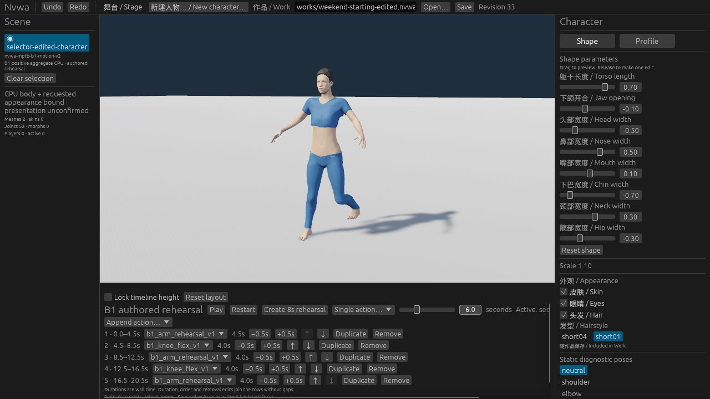
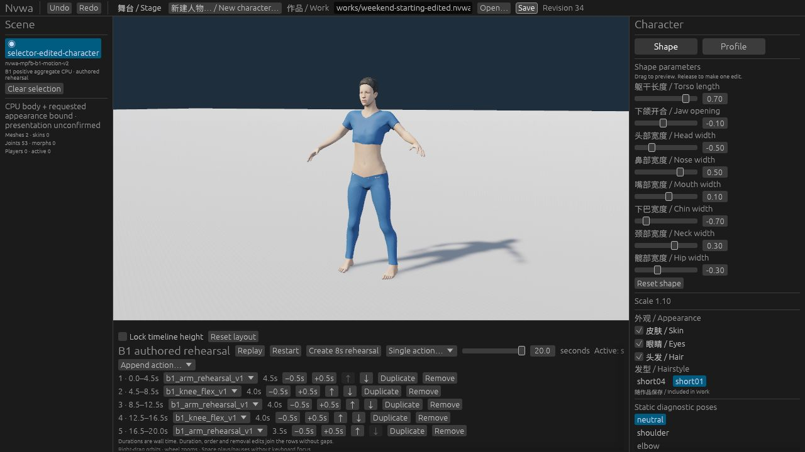

# B1 多段编排：本地阶段记录

本阶段已通过新 Web 界面的实际操作，将现有人物的单段循环动作编排成五段有限序列，并完成 Web → CLI → Web 文件交换。人物身份、八个参数、short01 外观、1.10 缩放与舞台均保留。本记录对应 [#126](https://github.com/Derek-X-Wang/nvwa/issues/126)；独立的离线创作示例见 [Agent CLI 指南](../../examples/b1-agent-authoring/README.md)（[#127](https://github.com/Derek-X-Wang/nvwa/issues/127)）。

## 实际操作与保存

1. 通过 Web 的正常作品 URL 加载 revision 21 的已编辑作品：一个四秒循环 arm 动作。后续打开 CLI 输出时使用正常文件选择器。
2. 追加 knee，复制首个 arm，并实际 Undo／Redo。再复制尾部 knee、追加 arm，得到五行二十秒序列。删除尾行后 Undo 恢复，再将 knee 上移。
3. 将首行动作时长改为 4.5 秒，并实际 Undo／Redo。正常 Save 下载 [Web 作品](web-saved.nvwa.json)：revision 33，五行，20.5 秒。
4. 实际 Play 后在 10.79 秒 Pause。暂停时用普通数值输入 Seek 到 6.0 秒，画面显示 knee 屈膝。继续播放至 20.5 秒，按钮显示 Replay。
5. 真实 CLI 执行 validate、inspect、apply、validate、save、validate，六次均 exit 0。[实际命令](cli-edit.command.json) 使用 revision 33，只把末行时长 4.0 改为 3.5 秒；[CLI 保存作品](cli-saved.nvwa.json) 为 revision 34、20.0 秒。
6. 通过正常文件选择器打开该 CLI 文件，再正常 Save。[Web 回读作品](web-reopened-readback.nvwa.json) 与 CLI 保存文件全字节一致。实际播放至 20.0 秒，按钮显示 Replay。

| 行 | 动作 | Web 保存的时间段 | CLI 修改后的时间段 |
| --- | --- | --- | --- |
| 1 | arm | 0–4.5 秒 | 0–4.5 秒 |
| 2 | knee | 4.5–8.5 秒 | 4.5–8.5 秒 |
| 3 | arm | 8.5–12.5 秒 | 8.5–12.5 秒 |
| 4 | knee | 12.5–16.5 秒 | 12.5–16.5 秒 |
| 5 | arm | 16.5–20.5 秒 | 16.5–20.0 秒 |

五行 ID 唯一，连续无重叠，均为非循环。CLI 修改前后仅 revision 与末行时长变化。两段源动作是既有的 Nvwa authored rehearsal；编排没有生成新动作。

## 证据身份与边界

[证据清单](evidence.json) 保存作品、命令、原始截图及来源收据的 SHA-256，实际操作记录和六次 CLI 的输出／退出码。截图直接复制，未裁剪或修改。公开收据只将 CLI 可执行文件与素材根目录的机器路径替换为变量名。

新 Web 导出确实完成编译：exit 0，1780.10 秒。捕获的 UI 提交为 `8c1c3e04989c8086a6c59836aca7830cc89e40fc`，树为 `d470e0ab33f5b14b8e4dc26bce5e7256e895ba9c`；273 个构建输入哈希与已审计 checkout `0817e4aa8822e2cba4eaaf1eef1332b372e6e1af` 一致。这里使用新界面做验收；CLI 仍复用来源等价的已有验证构建，不称为新 CLI 编译。

本地现有检查结果：81 个 Studio 测试通过；prepare 为 normal 6／optimized 6；frozen 为 normal 30／optimized 30。完整 portable 命令的 16 组按目录顺序全部执行并通过，耗时 970.55 秒。随后对未变的完整 eye 类别单独计时：20组 normal／optimized suite 全部通过，247.04／480 秒；测量源码为 `0817e4a`。本地计时不能保证 hosted 步骤或整个作业的耗时。

CLI 输出与 Web 回读的共同 SHA-256：`328d9180471cedbd4d3db36383a802b436346dbf0654507925e23e86e7407e67`。

VERIFIED — 新 Web 增删、复制、排序、时长、Undo／Redo、播放／暂停／Seek／有限结束及完整文件交换；原人物内容保留。PARTIAL — 发布阶段尚未完成；最终 CI、合并与 main-ref 验证另在 #126／#127 留存，不从本记录推断。NOT-RUN — 桌面 GUI、无辅助真人 Alpha、性能和人物／衣物／外观／动作质量验收。已有质量 HOLD 不变。
