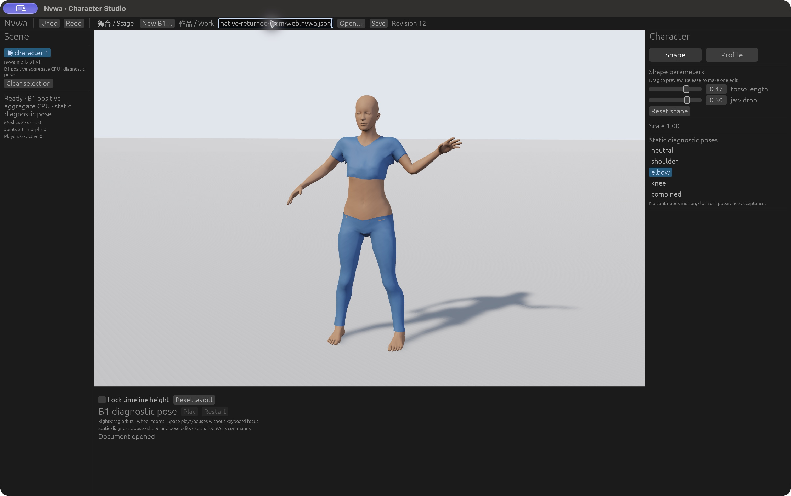

# Native GUI and desktop/Web follow-up

This later acceptance stage used the **same corrected native executable, CLI and Wasm** as the [earlier Web/CLI/CPU publication](VALIDATION.md). That historical record correctly said native GUI was not run while the Mac was locked. Once available, the actual native application and a fresh Web tab completed the bounded controls, rejection/recovery and full Work exchange below. No new build or complete toolchain/reproducibility claim follows.

[New evidence manifest](native-validation/MANIFEST.json) authenticates this document, the refreshed front page and the new raw files. Earlier validation files remain unchanged; only the README entry in their manifest is refreshed. Three approved native screenshots and three Web screenshots are copied **without retouching, cropping or substitution**. Retained native pose/history/failure screenshots containing local absolute paths were inspected during publication but remain private. Raw full Works and sanitized receipts substantiate the published state boundaries.

## Artifact and restored-source identity

[Artifact receipt](native-validation/artifact-identity.json) records native executable `eafd57d3a07362fdbda86fd8c859eba9d8f62c2749ac3d6b92484438d65477a4`, CLI `ea8182093c2bfcfb0b78e733154e612b351c78b71b12e69818e59dbbe557feec` and Wasm `cd401d198c733c91efade939b690f9e950173ba8da2bb509e53a94026384a579`. These were independently measured again. All 170 selected product-source hashes matched the earlier selected inventory, including corrected `b1.rs` hash `f5edb496e98ad7b83b30a66eb0f2f49ef0a468910f0047ac329ae4b1f07f7189`.

The [current served map](native-validation/served-output-sha256.json) has 50 entries. All 49 historical entries remain unchanged; the sole addition is `works/b1-native-exchange.nvwa.json`. This adds a served Work fixture, not different runtime code. The [HTTP log](native-validation/network/web-exchange-http.jsonl) retains the fresh Web load with paths/statuses and no host/query.

Only the task-owned application bundle's rig was made missing or corrupt. The [fault journal](native-validation/asset-fault-journal.json) records the original40,936 bytes, corrupt29 bytes and exact restoration SHA256 `b324ddb4b707721c19630bfadb87c3e3b38eed3b6e4590bb3cead43ea918f799`. Publication rechecked that actual restored file and every one of the 13 packaged raw input lengths/hashes. The retained [actual CLI validation result](native-validation/cli-validate-native-edited.log) reports asset_checked:true, valid:true and revision10 after restoration. No repository source asset was changed by these faults.

## Actual native controls, rejection and recovery

The [initial native New B1 view](native-validation/images/native-grounded-new-b1.jpg) shows the zero neutral Work, two display meshes and53 bones, full body above the floor and front visible. Native Save produced the canonical zero Work. Retained action screenshots record these completed edits:

| Revision | Native action and result |
| --- | --- |
| 1 | Torso click edit to0.47. |
| 2 / 3 | Undo restores0; Redo restores0.47. |
| 4 | Jaw click edit to−0.53. |
| 5 / 6 / 7 / 8 | Shoulder, elbow, knee and combined static diagnostic selections. |
| 9 / 10 | After rejected opens, Undo returns knee; Redo returns combined. |

The [public native edited view](native-validation/images/native-edited-public.jpg) shows revision10 combined with torso0.47/jaw−0.53. Actual native GUI Open rejected malformed Work JSON, a missing rig and a corrupt rig while retaining the committed render/Work. The complete revision8 saves before and after all three failures are byte-identical. History still worked afterward. Restoring the exact rig and explicitly retrying reached a zero neutral Work byte-identical to the fresh canonical CLI zero.

[Initial-results receipt](native-validation/native-initial-results.json) and [independently computed full-byte comparisons](native-validation/work-comparisons.json) bind the raw Work files. Native continuous drag and synthetic Command+A/paste attempts did not perform their intended actions. Successful acceptance used click edits and triple-click plus text typing. This does **not** newly verify physical native drag, shortcuts or IME, and does not diagnose those attempts as product failures. #3 remains blocked.

## Actual native GUI → Web → native GUI exchange

The native GUI saved revision10, reopened and saved it again. A fresh Web tab loaded that exact native Work, then saved it without changing full file bytes. [Opened-native view](native-validation/images/web-opened-native-work.jpg) shows revision10 combined/0.47/−0.53. In the actual Web application, selecting [elbow](native-validation/images/web-edited-for-native.jpg) produced revision11; a jaw control edit to0.50 produced [revision12](native-validation/images/web-final-edit.jpg). Actual native GUI Open and Save of that Web result produced the byte-identical final revision12 Work shown above: torso0.47, jaw0.50, elbow.

| Complete file equality boundary | SHA256 |
| --- | --- |
| Native baseline = native recovered zero = canonical fresh CLI zero | `91e51a4d1c8e80a01a986399ab2eeb54fc303dcf21aaa652931cff007d9538da` |
| Native revision8 before rejection = after invalid Work = after missing source = after corrupt source | `3319a9b324a6400cd8e6c0f31bb2483d92db13300fed500553f6de399ec1db52` |
| Native revision10 after history = native reopen/save = exchange input = Web resave | `95f49d206de7d4ece66f8fbcc0c366cd8eb8768bfb0217f70ebd9007fa482bc2` |
| Web final revision12 = native GUI returned revision12 | `9a805e9bad7891886bc39a332bda15293ce2d0edc42f1944694da17aabf85613` |

These comparisons cover complete JSON bytes, including profile, recipe, stage and timeline. They are not parameter-only comparisons. [Exchange receipt](native-validation/desktop-web-exchange-result.json), [Web results](native-validation/web-exchange-results.json), and the raw Works are retained. An initial coordinate-targeting attempt left the default GLB revision0 correctly retained; it is **not** counted as a successful exchange. The later correctly targeted native Open/Save is supported by the matching revision12 output and public native image.

## CI, cleanup and retained gates

CI39001841383 passed portable but failed macOS formatter scope before later checks. The fix selects each isolated probe's first-party package rather than formatting frozen vendor dependencies. Local exact red/green formatter checks passed and the bounded CI-only fix was independently reviewed. A new final-head CI run awaits root push; **no final CI, merged-main or merge pass is claimed**. Native GUI results use the unchanged compiled product, separate from the pending CI-only change.

Root verified that both task native processes, the task Web tab and server stopped; the listener was released. Exactly three hash-matched task downloads were reversibly archived, and the asset backup was consumed after exact restoration. No unrelated download or process was included. Publication created no background resource. [Observation scope](native-validation/observation-scope.json) retains the bounds.

The earlier initial Web bootstrap abort and unproven transport clue remain in the historical record. This follow-up is **not a cold-start or performance pass**. Only the approved body/sportsuit, two signed parameters and five static poses were exercised. Appearance/cloth quality, extreme-fold normals, arbitrary input, continuous B1 motion, performance, full public-release notice closure, signing/notarization and clean-machine launch remain unaccepted. B1 GPU4 and M2 action quality remain HOLD; A remains a numeric control; #3 remains blocked and #4 retains its measurement gaps.
