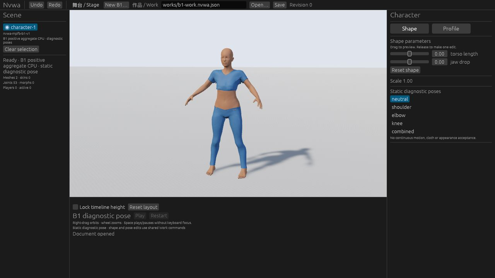

# B1 production Work integration (#74)

The corrected production Web build displayed the approved body and sportsuit above the existing floor, facing the camera. Its five static poses, both shape controls, Undo/Redo, Web → CLI → Web save exchange, rejected source loads and explicit recovery were exercised. The retained evidence is in [VALIDATION.md](VALIDATION.md).



| Boundary | Recorded result |
| --- | --- |
| Workspace CPU tests | 155 passed: 49 runtime, 59 Studio, 47 core/CLI. |
| Native build/package | Passed; all 13 packaged raw inputs authenticated. Native GUI was **NOT-RUN** because the validation Mac was locked. |
| Corrected Web | Built and used; poses, edits, history, file exchange and warm-cache source rejection/retry recorded. |
| Startup | Initial bootstrap aborted; reload succeeded. Cause is unproven. **No fully cold startup pass.** |
| Desktop GUI ↔ Web exchange | **NOT-RUN**. Web ↔ offline CLI exchange is separate evidence. |
| Final-head / merged-main CI | **NOT-RUN at this publication**; no merge acceptance claimed. |

## Reproduce

```sh
cargo build -p nvwa-cli --locked
target/debug/nvwa-cli new-b1 assets character.nvwa.json
target/debug/nvwa-cli validate character.nvwa.json assets
cargo run -p nvwa-studio --locked -- --work "$PWD/character.nvwa.json"
```

The [diagnostic example](../../../examples/b1-diagnostic.nvwa.json) is an actual CLI-saved full Work. B1 uses the shared commands and stage, two signed parameters and five diagnostic poses. It has no continuous clips. GLB remains the default entry. Open/New authenticates B1 inputs before replacing the committed Work; Save during a pending candidate saves the committed Work, and editing cancels that candidate.

Run `python3 -B scripts/verify-b1-inputs.py`, `python3 -B scripts/test-b1-inputs.py` and its `-O` form for portable input checks. `bash scripts/check-b1-work.sh` runs the CPU/native/Web package gate with an existing wasm-bindgen0.2.129 tool; `NVWA_WASM_BINDGEN` selects that existing tool. Graphical use remains separate. See [source admission](SOURCE-ADMISSION.md) and [placement regression](STAGE-PLACEMENT.md).

Only the approved sample is admitted. B1 GPU4 remains HOLD; A remains a numeric control. Original eight-recipe/five-pose results remain historical experiments53–59. Appearance, cloth folds/poke-through, extreme-fold normals, continuous motion and performance remain unaccepted. #3 remains blocked; #4 retains its measurement gaps; M2 action quality remains HOLD. Full public release notices, signing/notarization and clean-machine launch remain unverified.
