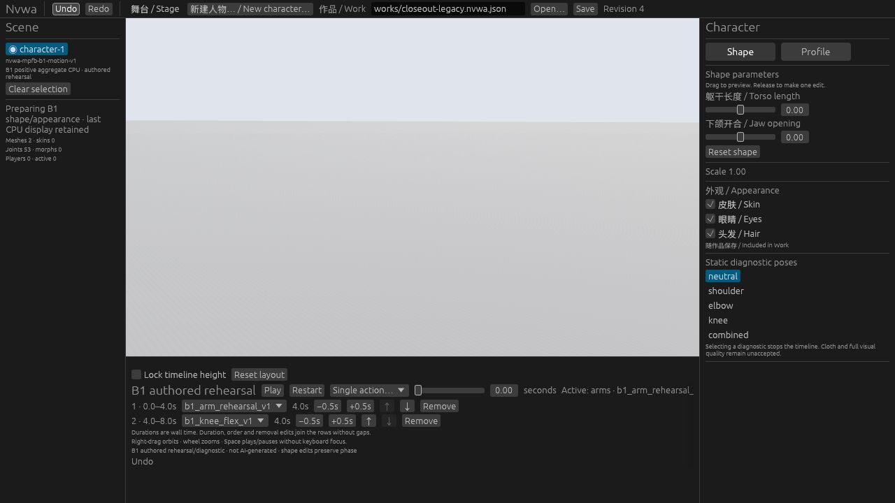
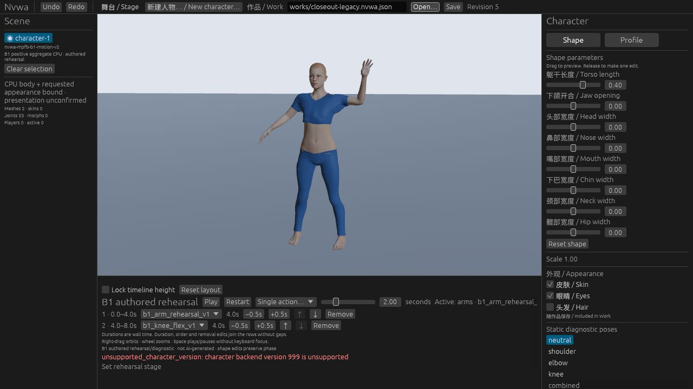
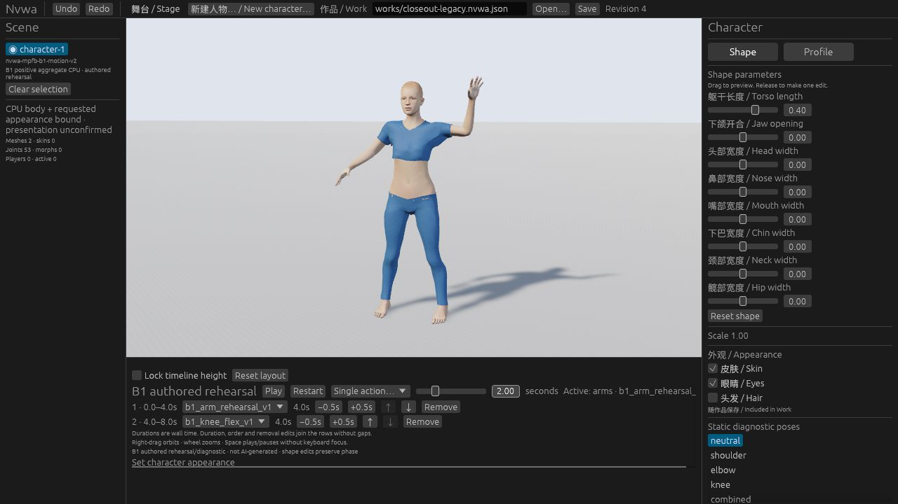
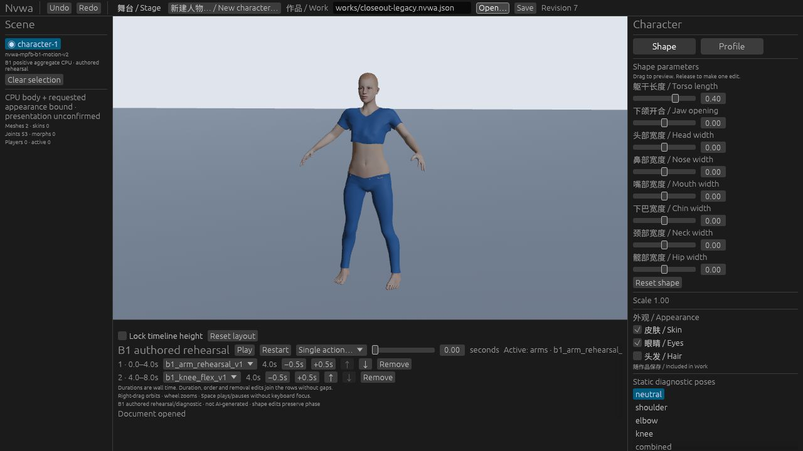

# Character closeout: ordinary Web and CLI — 2026-10-20 UTC

**PARTIAL — #87's version message and Work protection pass; existing #86 feedback and one ordinary Web/CLI regression are verified within the observations below. Three empty character samples remain. #86 stays OPEN/HOLD. This is local acceptance evidence, not final hosted publication or a quality/release approval.**

This bounded closeout starts from main `d21dfcf0f717c2d25865a42b4094351bfdfe7069` after PR #100; its [natural main CI](https://github.com/Derek-X-Wang/nvwa/actions/runs/39377322274) is verified. Final independent review, exact PR-head CI, merge and natural main CI for this closeout are recorded in [#87's associated PR completion ledger](https://github.com/Derek-X-Wang/nvwa/issues/87). Baseline CI does not certify the closeout. The [stage freeze and retro packet](../../closeout/character-foundation-20261020.md) becomes ready for retro only after that publication gate.

## Source and controls

The actual ordinary Web build has Wasm SHA-256 `3c1a05e760648ebdc8f68b93d6dd09a15eaa6950a958ca2cd7094cbed940dec4`. All 249 receipt-listed source files match the integrated checkout. The server script matches the repository script; fixture copies were added to the served site without changing the built package. The ordinary URL used only a `work` query, with no benchmark or diagnostic application controls. [observations.json](observations.json) retains the relative source hashes, fixture hashes, test names and artifact identities. This establishes the selected build closure, not whole-repository equality or a signed build attestation.

Final integrated controls passed: **69 unique Core/CLI tests and 16 unique runtime controls** (11 issue86, three pending-Open, one Open error and one motion-Open error). No ignored or failed case is counted. These logs belong to one integrated source snapshot, tree `6273102f5138fe806489fe2fa19314b8c23aaa04`. Earlier mutation/red-restoration work is a separate cohort and is not added to these fresh counts. CPU controls are separate from actual browser images.

#86's presentation-unconfirmed status repair already exists in the baseline. The closeout adds a scheduled-feedback invariant to existing lifecycle checks; it does not change the renderer. #87 removes the inaccurate “expected 1” suffix while keeping `unsupported_character_version`, the same supported versions, strict identity validation and atomic rejection.

## Actual ordinary Web observations

| Operation | Recorded outcome |
| --- | --- |
| Legacy two-parameter Work | torso 0→0.4, revision 2→3; one Undo restores 0 at r4; one Redo restores 0.4 at r5. |
| Eight-parameter Work | Open r0, torso 0→0.4 at r1; one Undo restores 0 at r2; one Redo restores 0.4 at r3. |
| Playback and seek | Play/Pause samples show 0.1351/0.1506 seconds. A track click intended near 2 seconds landed at 8.00; a later numeric entry visibly confirmed exactly 2.00 and the arm peak. This is short advancement and seek evidence, not full-cycle or continuous-playback acceptance. |
| Appearance and stage | Hair true→false at r4; Skin/Eyes stay selected. Actual key light 10000→8 lux at r5. The automation intended 8000 but committed 8. Cause UNKNOWN; this run does not establish correct multi-digit numeric entry, and no product/input-scale cause is assigned. |
| Unsupported version | Version 999 reports `unsupported_character_version: character backend version 999 is unsupported`. The current r5 Work, torso 0.4, Hair off, stage 8 and paused pose 2 remain. |
| Malformed Open and history | A separate malformed JSON Open shows its specific error and retains the same Work. After both rejected Opens, one Undo restores 10000 lux at r6; one Redo restores 8 at r7. |
| Save and reopen | Actual normal Save downloaded 3700 bytes. CLI asset validation, inspect, save and revalidation all exited 0. Ordinary Open of the exact CLI-saved Work settles at r7, torso 0.4, Hair off, stage 8 and timeline 0, with the error cleared. |

Three sparse samples show an empty character view: legacy Undo, eight-parameter edit and eight-parameter Redo. All three show **Preparing B1 shape/appearance · last CPU display retained**, rather than Ready. The image below retains the failure. That CPU retention statement is not proof that the display contains the character; later images do not establish a maximum blank interval, self-recovery for every operation, or absence of interruptions between samples.

These four original 1280×720 JPEGs were inspected and copied byte for byte. No crop, re-encoding, redaction or generated image was used. Their timestamps are observation intervals, not presentation-duration measurements. The remaining original screenshots and raw receipts stay local; their hashes remain in observations.json.

## Actual files and CLI boundary

The [actual Web-saved Work](web-saved-v1.nvwa.json) is 3700 bytes, SHA-256 `c9bdbe52fb8dfcc68fcdf7f1f82ac060cad61a6979e7a5c55f11621107e6755f`. Its CLI-saved copy is byte-identical. An independent structural comparison with the actual opened character example finds exactly four changed fields:

| JSON pointer | Before | After |
| --- | --- | --- |
| `/revision` | 0 | 7 |
| `/character/parameters/torso_length` | 0 | 0.4 |
| `/character/appearance/hair` | true | false |
| `/stage/key_light/illuminance_lux` | 10000 | 8 |

A separate actual CLI `new-character → describe-capabilities → validate → save → validate → inspect` run exited 0 throughout. Its created and saved files are byte-identical 3303-byte Works, SHA-256 `6be12f7979f66e08b12b939dc63afcb87820bf90b2609e8c01c563eab99b3d14`. This is offline file-operation evidence; the CLI does not render or control Studio. Reproduction entrypoints are in the [small regression guide](../../closeout/character-foundation-20261020.md), [CLI authoring contract](../../agents/cli-authoring.md) and [ordinary Web regression](../web-edit-regression-20261018/README.md).

## Limits retained

**NOT-RUN:** continuous presentation trace, exact first presentation, worst empty interval, completely cold browser/GPU state, GPU timing/memory, full quality cohort, new ordinary desktop UI regression and a new human trial. Desktop remains deferred by the [current policy](../../agents/verification.md). The owner records the task-owned browser tab closed and server no longer listening; this is bounded owner-reported cleanup.

#3 stays blocked; #4 keeps its measurement gaps; #49 remains open. #79, #80 and M2 quality remain HOLD. No new shoulder/hairline candidate, model run, infrastructure refactor, release approval or quality admission follows from this closeout.
