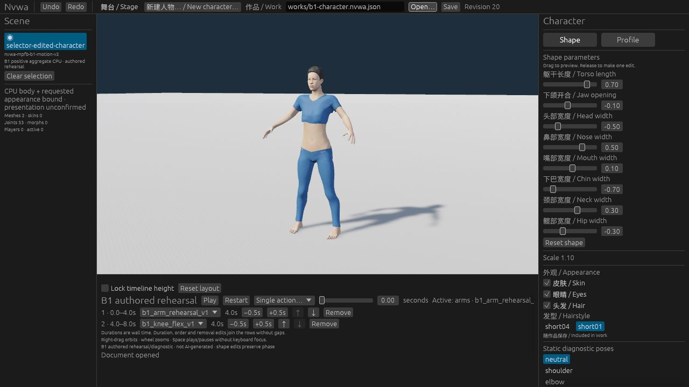
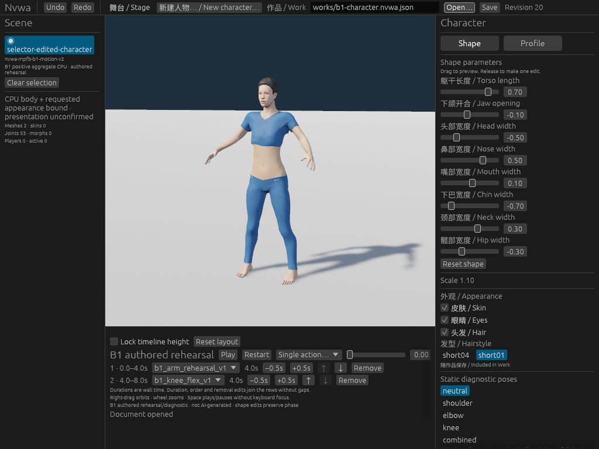
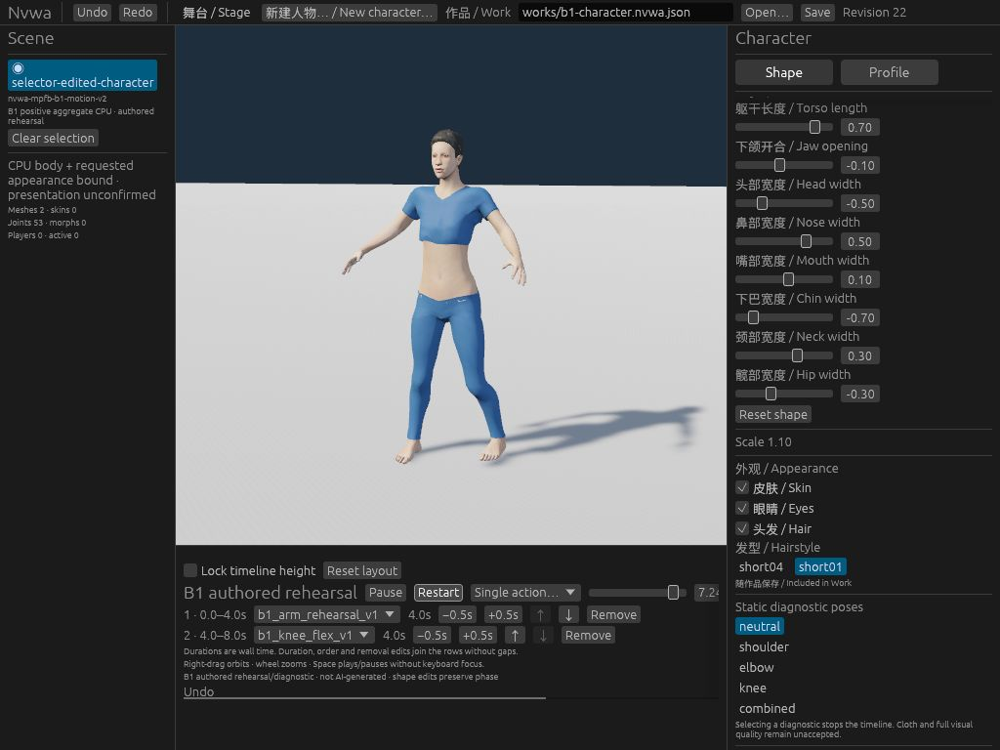

# Editor hairstyle selector: local acceptance snapshot

2026-10-28. Candidate based on `7b5796c1e48b3895720b1b9fd388e984f8f7bccf`.
This records local checks, compiled artifacts and completed actual Web/CLI
acceptance within the original 30-minute budget. Feature PR/main CI and
publication remain **NOT-RUN**. Later publication and CI receipts belong in the existing
[#79 record](https://github.com/Derek-X-Wang/nvwa/issues/79).
[PHASE1.md](PHASE1.md) remains the unchanged historical candidate-stage record.

## Editing contract

For base V2, the existing appearance section offers short04 and short01 on the
current edited Work. The existing SetAppearance command owns the saved change.
Actual-control tests cover all eight shape values, role flags, Work identity,
stage and timeline, one Undo/Redo per real switch, and no command for the current
option (including preserved Redo). Hair-off disables pointer/keyboard switching.
Existing all-off None, default re-enable, V1 and GLB behavior remain covered.

The two existing assets and current Work format are retained. There is no new
Core/runtime/CLI/schema/asset/default or dependency behavior. This adds no
appearance-quality, generated-action or all-frame motion acceptance.

## Verified local checks

| Check | Actual evidence |
| --- | --- |
| Independent R2 | Static APPROVE; execution and product acceptance were separate. |
| Focused UI development | 8 passed, 0 failed; actual production controls, CPU paint and transactions. |
| Complete portable catalog | All 16 groups once, exit 0; 723.275s / 1200s. Original commands, normal/-O and Node failure controls retained. |
| Eye/hair group | 112.199s / 180s; includes retained and expanded Experiment 73 controls in both Python modes. |
| Native workspace tests and check | 237 passed, 0 failed/ignored/filtered, then workspace check passed; 1901.346s for the combined gate. Includes Studio 74 and runtime 86. |
| Wasm check | Exit 0, 362.192s. |
| CLI build | Exit 0, 10.943s. |
| Web build/package | Exit 0, 379.196s; original dev build and existing wasm-bindgen 0.2.129. |
| Native/Wasm/CLI/Web preparation | One run, no retry or parameter change; 2655.055s / 3600s including export verification. |

Times are command/gate wall times, not pure compiler or performance benchmarks.
Local timing does not establish hosted CI timing. No formal failure was retried.

The Web source receipt covers 271 entries: Cargo.toml/Cargo.lock and all files
under crates, vendor, assets, scripts and web, excluding __pycache__. Every entry
matches the frozen source. Eleven supplemental example/license/config/toolchain
inputs also match. The complete exported site has 96 files (190,042,177 bytes).
The fresh executable CLI is 1,918,888 bytes. Both exports were verified against
the producing build before its temporary checkout was removed.

## Exact identities and preservation

| Artifact | SHA256 |
| --- | --- |
| appearance_ui.rs | `c8af599556fa6ff1c32276cb9b5a4aef8a384a297a832952b9a262a734bfc894` |
| appearance_ui_tests.rs | `5e3aff9ae92295b6062b6ce0cfdf1f0d23839059709ce9f3550bb762080b3d34` |
| Fourth context, source-context-hair79-selector-v1.json | `c0416baa1cf9cb49e34217173ff37d00f02299fb782c83815602dab1977c5d35` |
| Exported CLI | `786f2934725043b3d20913f3c017b68bca2da81fb04db07331d77f5202833edd` |
| Exported nvwa_studio_bg.wasm | `c7d021880f2147c2f9674a436c2e1caf85614427d1dd714e48c977a80bdc8fe5` |
| Web build-receipt.json | `f9eff9bec773f41e1781c36eaca4efa98a57d6ac0d5f486f2132a54697ee5a9b` |
| acceptance-input.nvwa.json | `1ba0f8a3839154c36a537bb0b52106f853028e5145aefca47253ab904cedf593` |

The fourth context uses the existing exact whole-map mechanism. The original
manifest, three prior contexts, old source pins/blobs, numeric functions/data
and thresholds remain unchanged. Only two old UI blobs were added to the
fixture inventory. All 307 other pinned source paths and 82 historical
Experiment 73 paths remain byte-identical.

Both normal and optimized Python formally passed the separate old matrix
**3 accepted / 12,285 rejected**, the old subspace against the expanded gate,
and the expanded matrix **4 accepted / 27,644 rejected**. All old subprocess
crossover/fault controls remain, with new-versus-old and new-input controls.
This admits one complete selector source snapshot; it does not relabel old
captures or historical execution as evidence for these new bytes.

## Actual ordinary Web and same-file CLI exchange

The original worker recorded a pre-navigation adapter STOP when its prior
browser binding was unavailable; the cause was not diagnosed. That STOP is
retained. The root controller independently read an available, empty browser
inventory, created a fresh background tab and exclusively completed only the
unexecuted steps within the original 30-minute budget. No unlock, OS input or
safety-setting change was used.

| Actual operation | Observed result |
| --- | --- |
| Edited V2 input | Revision17; all eight distinct values, identity/profile, scale1.1, neutral pose, authored timeline and nondefault stage retained. |
| Click short04→short01 | Revision18; intended visible hair change. |
| Undo; select current short04; Redo | Revisions19→19→20. Current-option input added no edit and retained Redo. Direct reverse switching also worked. |
| One actual Save, then Open that download | Download and reopened Work retained short01/all roles/revision20. |
| Same-file CLI inspect/validate/save/validate | All four commands exited0, using the complete existing assets. Parsed JSON, downloaded bytes and CLI-counterpart bytes matched. |
| Open CLI counterpart in ordinary Web | Restored short01/all roles/revision20; same character and complete edited Work retained. |
| Roles/defaults | Skin-off survived switching; Hair-off disabled pointer input and Tab caused no mutation; re-enable retained short01 while another role remained. All-off became None; re-enabling used default short04. |
| Keyboard, scrolling and size | Actual Tab/Enter switching and normal inspector scrolling at1280×720/DPR1 and1024×768/DPR1. |
| Existing V1 and GLB | V1 had no new selector; old Hair/Undo worked. GLB opened its nine-second authored sequence and reached the observed turn pose. |
| Authored B1 playback | Actual0.1s and7.24s views showed pose progression/knee bend with short01 retained;8s completion also observed. These samples are not all-frame or quality evidence. |

The saved Work equals the input in every field except appearance/revision; its
complete appearance object equals the existing admitted short01 reference.
The actual download and CLI-saved counterpart share SHA256
`d3cce85c3f1397a74c5cabdcd720f5fe1c46390e1ab958a45a3c0e9e6db9a7f2`.
The receipt script raised KeyError on an incorrect metadata key after all four
CLI commands and preservation assertions succeeded; only metadata was corrected
against the complete reference, with the error retained, no command/Save rerun
or first-invocation exit0 claim, and individual command timings **unknown**.

No console warnings/errors were observed in this bounded run. Cleanup was
verified: the task browser tab was closed, its viewport override reset, and
the task server stopped with its port released. The single actual download
was identified by its verified SHA256 and moved into retained evidence; it
keeps the same bytes as the mirror and CLI counterpart. Existing previews,
other listeners and other downloads were left untouched. Browser execution
is separate from the deferred native GUI and future feature CI.







These three nonduplicate original JPEGs show the final edited Work, narrow
viewport and one authored pose. Other captured views remain in the retained
acceptance record; none establishes all-frame motion or appearance quality.

## Acceptance-only input and reproduction

[acceptance-input.nvwa.json](acceptance-input.nvwa.json) is a 3,724-byte test Work,
with eight distinct shape values, nondefault stage, scale 1.1 and two authored
actions. It is an acceptance fixture, not an aesthetic preset. It is not added
to examples, the starter page or the Web package.

Use the repository's existing pinned tools and complete existing assets. These
commands document reproduction; the actual exchange above is already recorded.

```sh
python3 -B scripts/check-portable.py all
bash experiments/27-ci-baseline/check.sh native
bash experiments/27-ci-baseline/check.sh wasm
cargo build -p nvwa-cli --locked --offline
# WASM_BINDGEN: existing wasm-bindgen 0.2.129 executable
NVWA_WASM_BINDGEN="$WASM_BINDGEN" bash scripts/build-web.sh dev

# CLI: existing compiled nvwa-cli executable
# ASSETS: complete existing assets directory
"$CLI" inspect docs/evidence/hair79-selector/acceptance-input.nvwa.json
"$CLI" validate docs/evidence/hair79-selector/acceptance-input.nvwa.json "$ASSETS"
# After the real browser Save, use the actual downloaded Work:
"$CLI" inspect "$BROWSER_DOWNLOAD"
"$CLI" validate "$BROWSER_DOWNLOAD" "$ASSETS"
"$CLI" save "$BROWSER_DOWNLOAD" "$CLI_SAVED_WORK"
"$CLI" validate "$CLI_SAVED_WORK" "$ASSETS"
```

Open the acceptance Work in the ordinary Web editor. Switch short04→short01→
short04 on that same edited character, check neutral view and ordinary authored
playback, one-step Undo/Redo, same-option no-op, roles, Hair-off, all-off/default,
V1 and GLB, keyboard use and both supported sizes. Save the actual browser
download and reopen it; inspect/validate that same file with CLI and reopen
the CLI-saved counterpart in Web. Compare complete Work fields and output hashes
as recorded above.

## Pending evidence and retained limits

| Scope | Current status |
| --- | --- |
| Real Web selector/render/keyboard/two-size behavior | VERIFIED within the bounded actual run above. |
| Actual browser download/reopen and same-file CLI/Web exchange | VERIFIED; all four CLI commands exit0, identical bytes and full parsed JSON. Individual command durations unknown. |
| Normal feature PR/main CI and publication | NOT-RUN; later receipts belong in #79. No future PR number is reserved here. |
| Routine native GUI acceptance | NOT-RUN, deferred by milestone policy. |

#120/M2/#80 remain HOLD. #112's original failure, #3's block and #4's measurement
gaps remain. Compilation and local controls do not establish GPU quality,
contact, all poses/frames, generated motion or performance. The previous static
entry release (#121/PR122) is verified separately; its main CI result does not
certify this selector.

**VERIFIED — local automatic checks, native/Wasm compilation, artifact identity
and bounded actual Web/CLI acceptance. NOT-RUN — feature CI/publication and
routine native GUI acceptance (deferred by policy).**
