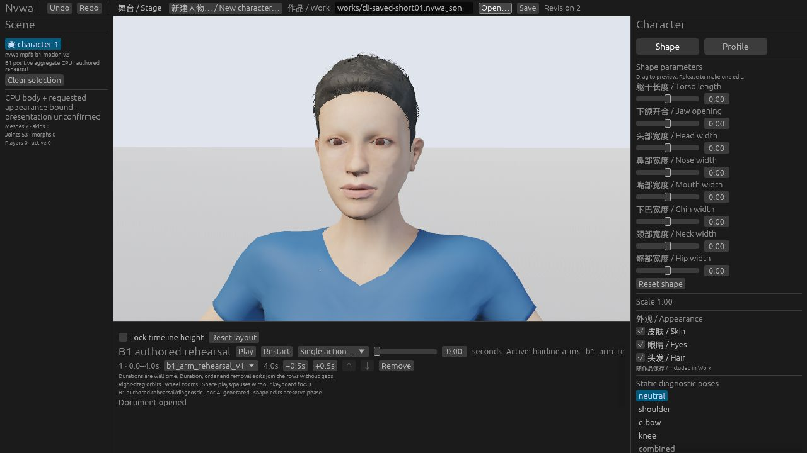

# Optional short01 appearance: bounded quality and file exchange

This adds an explicit hairstyle for the existing eight-parameter B1 character.
Old Works and constructors keep short04. This is a fixed CC0 asset selection,
not generated hair, a new character backend, or a new Work schema.

## Independent identity

- Set: `mpfb-b1-cc0-appearance-v2-short01-v1`.
- Descriptor: `appearances/mpfb-b1-cc0-v2-short01-v1/manifest.json`.
- Descriptor SHA-256: `8c2044ee524a700abd75479c457d2e269f7e280a67509749c9fd780794c6d49a`.
- Four original hair files, existing skin/eyes, source notices, full upstream
  metadata and CC0 license: fourteen authenticated payloads, 7,147,241 bytes.
- Existing full-positive signed fitting, 53 bones and material policy retained.
  The hair has 2,984 source points, 3,177 expanded corners and 3,678 triangles.

## Quality decision before product implementation

The [archived experiment92](https://github.com/Derek-X-Wang/nvwa/blob/554faa7ce058eb7793e48162803c82b46535b6c7/experiments/92-hair-short01-cohort/RESULTS.md)
used seven body/action Works, held samples0/2, fourteen A/B/A triples,
42 actual records and 28 held images. Four default-case playing witnesses
added bounded sampled motion evidence. Its original visual result remains
PARTIAL because the two positive body cases cropped the upper head.

The separate [experiment93 supplement](https://github.com/Derek-X-Wang/nvwa/blob/554faa7ce058eb7793e48162803c82b46535b6c7/experiments/93-hair-short01-framing/RESULTS.md)
changed only the two affected Works' camera target height from1.50 to1.60.
Its four A/B/A triples, twelve actual records and eight original images passed
the same numerical/source controls and independent visual review. Forehead,
eyes, front hairline and crown were visible. This closes the bounded frontal
visibility gap while retaining the original cropped records and failed checks.
It does not certify side/rear views, contact, all animation frames or all shapes.

The accepted numerical comparison uses each record's full fitting cage and
53 bones. It is not independent body reconstruction or a GPU readback claim.
The source/material identity is preserved when moving the accepted asset into
the normal product runtime. The experimental controller is not shipped here.

## Actual ordinary Web and CLI exchange

The normal product Web build was opened with a genuinely CLI-saved Work,
without an experimental controller or overlay. The actual operations were:

1. CLI `describe-capabilities`, `inspect`, `apply`, `validate`, `save`, `inspect`,
   `validate`: all returned0. Only the selected appearance and command revision
   changed; body, authored action and stage remained intact.
2. Web opened that exact static Work and displayed short01. Web Save downloaded
   [the same bytes](web-saved-short01.nvwa.json) as
   [the CLI-saved Work](cli-saved-short01.nvwa.json), SHA-256
   `9a4b5f638a4dbb506bd911408b28920b0a0c8f5fb1565442a956995a4c46f669`.
3. The actual Hair checkbox removed hair. Saving the
   [edited Work](web-edited-hair-off.nvwa.json) preserved the independent
   short01 set, skin/eyes and every other Work field; revision changed2→3.
   Its SHA-256 is
   `2f856406377c0e2330b1d268734ae62f8b513466389da8eed920ecacc1000626`.
   CLI `inspect` and `validate` with the real asset root accepted both downloads.
4. The ordinary Open file chooser reloaded the first Web download: revision2,
   all three roles on and short01 visibly restored. Restart played the authored
   four-second arm clip; observed screenshots show0.2929s and completed4.00s.
   These are two instants, not an all-frame motion or performance measurement.



[Hair off](web-hair-off.jpg), [playing](web-authored-playback.jpg) and
[completed](web-authored-playback-end.jpg) are original browser screenshots.
No warning/error console entries were observed in this bounded run. That is not
a guarantee against unobserved errors. Task-created tabs and downloads are
cleaned up separately; retained evidence remains available.

## Local implementation checks

| Check | Actual result |
| --- | --- |
| Core/CLI tests | 76 passed |
| Full runtime library suite | 86 passed; zero ignored or filtered |
| Full Studio library suite | 70 passed; zero ignored or filtered |
| Relocated standalone archive | 11 tests passed, including old Works and new-set rejection paths |
| 72 source controls | 20 passed in each normal/`-O` mode |
| 73 source controls | 45 passed in each normal/`-O` mode |
| Ordinary Web build/package | Passed; source hashes unchanged during the build |
| Independent review | Product and source-context review passed; separate packaging/docs review passed |

The runtime suite calls production appearance update for a held-frame
legacy→short01→legacy cycle. It checks actual expanded geometry, source corner
mapping, decoded diffuse pixels, retained state and recovery. The Studio suite
clicks actual controls and exercises Undo/Redo. Neither suite claims GPU readback.
The complete portable run and hosted CI are recorded separately at publication.

## Reproduce

```sh
cargo build --locked --offline -p nvwa-cli
target/debug/nvwa-cli describe-capabilities examples/b1-short01.nvwa.json
target/debug/nvwa-cli validate examples/b1-short01.nvwa.json assets
target/debug/nvwa-cli save examples/b1-short01.nvwa.json /tmp/short01.nvwa.json
target/debug/nvwa-cli inspect /tmp/short01.nvwa.json
bash scripts/build-web.sh dev
python3 scripts/serve-web.py --port 9201
```

Use a new output path for each test. The build commands require the existing
pinned tools/dependencies. Then open
`http://127.0.0.1:9201/?work=works/b1-short01.nvwa.json`. For manual exchange,
Open the CLI output, Save, then inspect and validate the actual downloaded file.
The CLI's `apply`/`save` edit metadata; `validate` authenticates all selected-set
payloads, including disabled roles. Renderer readiness is separate.

## Boundaries

Independent code review and applicable PR/main CI remain separate publication
gates. The associated PR records their exact source heads and final results.
The historical72/73 checks retain original hashes and numerical execution;
their additional whole-source context only admits this product source snapshot.
It does not relabel old frames, historical execution or #112 as current PASS.

Routine desktop UI acceptance is NOT-RUN under the existing milestone policy.
Automated native/Wasm checks remain required. Broad#79 eye/hair/contact quality,
M2 and #80 remain HOLD; #112 keeps its original failure, #3 remains blocked and
#4 keeps its measurement gaps. No new model run, download, paid compute or
public binary release was part of this implementation.
