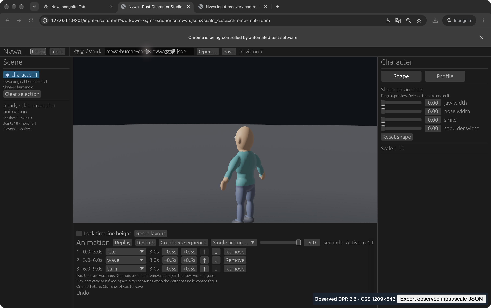

# Input recovery and supported browser scaling

2026-10-11. Production source cohort: merged main
`93c77d5d8409a6b142c1aeaa07a50b594bcecb29` (PR #30). This packet adds isolated
diagnostics and evidence. It changes no product source, root dependency or lockfile.

## Result and decisions

| Status | Case | Actual evidence and limit |
| --- | --- | --- |
| VERIFIED | Real Chrome tab departure/return | Trusted hidden/visible/focus and resumed input; no canvas click between return and typing. Exact Work sentinel and Save filename corroborate canonical text; complete saved Work unchanged. |
| VERIFIED | Chrome zoom 100% → 110% → 125% → 100% | Observed DPR 2 → 2.2000000477 → 2.5 → 2. CSS changes too. Visible Work clicks and settled proxy positions pass bounded geometry checks at 100%, 125% and restored 100%. |
| VERIFIED | Tool-issued jaw gesture and one Undo at 125% | Jaw 0 → 0.67 → 0; revisions 1 → 2 → 3; complete Work comparison preserves all other fields. Trace contains trusted down/up 13.3ms apart and no recorded pointer moves: endpoint/release evidence, not a recorded continuous trajectory. |
| VERIFIED | Derek's physical check at 125% | Derek reports **“三项全部正常”** for candidates near the caret, Space single selection/no pause, Command+A/V, tab-return Chinese input and continuous jaw drag/one Undo to 0. Separate human attribution; not an automatic trace verdict. |
| VERIFIED | Human final Work preservation | Saved handback restores all baseline content; aggregate revision 3 → 7. This does not establish the number of physical edits/gestures. |
| PARTIAL | Human DOM trace | One `compositionend` at sequence710 has `trusted:false`, origin UNKNOWN; full recovery trace has759 rows/no drops. Scale trace is only800 retained rows326–1125. Do not weaken the checker or claim whole-session proof. |
| NOT-RUN | Original IAB DPR-emulation failure | Current supported IAB viewport API exposes width/height only; original emulation trigger unavailable. IAB tab selection/visibility attempts did not produce actual page departure. No failure cause, upstream diagnosis or production fix claimed. |
| NOT-RUN | New native Studio/other platforms | Native Rust app, physical monitor migration, OS display-scale changes, fixed-CSS DPR isolation, other browsers and Windows/Linux were not tested this turn. Earlier native evidence remains tied to its earlier artifact. |

Close #2's remaining browser input cases within this Mac/Chrome scope; preserve
earlier native physical acceptance and its limitations. Keep #3 open for the
original IAB boundary. Normal browser zoom is a supported control, not reproduction
of the original emulator condition. Track untrusted-event provenance separately
as diagnostic uncertainty, not a demonstrated user input defect.

## Environment and runtime identity

Host read this turn: Apple M2 Pro,16GiB, macOS27.0.1/build26A434.
Actual observed User-Agent reports
`Mozilla/5.0 (Macintosh; Intel Mac OS X 10_15_7) AppleWebKit/537.36 (KHTML, like Gecko) Chrome/154.0.0.0 Safari/537.36`.
The UA OS token is not the measured host OS. Installed engine version and exact
Chinese input-method name were not separately collected.

Reused production Web artifact:
`nvwa_studio_bg.wasm` SHA256
`884134fc98d54e3476dbc799ffdd5cc6b88f69121ddfb649ed9ba9be96156dba`.
Production JS/index hashes are in [observer-package.json](observer-package.json).
All31 source/asset/build inputs match the prior final cohort manifest. The
prior103 Rust tests, strict clippy, dual builds and native acceptance are recorded
in [M1.1 UI acceptance](../m1-1-ui/ACCEPTANCE.md); they were not rerun this turn.
The actual Web page loaded the real9-mesh/9-skin/18-joint/4-morph character.
No mock or static image replaced the character runtime. No performance measurement
or AI generation is claimed here.

At100%, canvas CSS1512×806 and backing3024×1612; at110%, CSS approximately
1374.5454×732.7272; at125%, CSS approximately1209.6×644.8. Backing remained
3024×1612. Zoom changed CSS and DPR together. Work-field bounds `[257,1,222,22]`
are independent screenshot observations in CSS pixels, not exported Rust bounds.
Rust scale factor/egui pixels-per-point were not directly observed.

## Observations and attribution

The root operated actual native Chrome UI. The two observers record DOM geometry,
event classes, trust and lengths; they do not dispatch events, drive focus, change
geometry, or read arbitrary text/clipboard contents. The additional export button
is focusable and covers an unused bottom-right canvas area; export focus changes
happen after the evaluated input. Recovery publication is synchronous and scale
publication is RAF-delayed, so combined sections are not atomic. See the exact
executed [wrapper sources](reproduce/input-scale.html) and package hashes.

Chrome tab return: baseline `nvwa-issue2-before`, then activate the separate control
tab and return by the Chrome tab UI. Without refocusing the canvas, type
`-after.nvwa.json`. Rendered Work and default Save filename both equal
`nvwa-issue2-before-after.nvwa.json`. Recovery sequences115–118 record departure
and return; resumed input sequence122 precedes export focus events184–186.
The file path is UI state, not a field stored in portable Work JSON.

Geometry pairs:100%70→127 at250.9ms;125%296→361 at250.6ms;
restored100%496→560 at290.4ms. Caret anchors respectively373.375/21.25,
405.65625/21.40625 and402.1875/21.25 remain inside the screenshot field.
The checker verifies only these selected intervals. Canvas-only pointer coverage
and missing timer-origin IDs limit its event attribution. No stopped/session-end
row was collected.

Human handback screenshot shows `nvwa-human-check.nvwa女娲.json`, jaw0 and
revision7. Derek's report establishes visible candidates and physical shortcuts;
we did not capture candidate UI pixels or per-action timings. Native automation
paste at restored100% separately showed `女娲-reset100.nvwa.json`; it does not
substitute for a physical IME check.

The untrusted `compositionend` seq710 records length2 and the active visible
production proxy. Static review found no event dispatch in the executed observers,
production Web adapter or served wasm-bindgen glue. Pinned `bevy_egui` consumes
composition end; its relevant start/update listeners are mobile-gated. This does
not determine whether browser, OS, extension, provider or a DOM side effect
created the event. Checker19 conservatively returns PARTIAL on that whole trace.

IAB `recovery-before/away/after-visible-attempt.json` are identical and show no
real departure: preserved failed control attempts, not recovery acceptance.
`chrome-zoom125.png` is a popup-only shot; use the main/caret screenshots instead.



## Reproduce offline checks

From repository root; Python standard library and Node syntax checker only:

```sh
python3 -B docs/evidence/input-scale/verify.py
python3 -B experiments/20-scale-boundary/test_geometry.py
node --check experiments/19-input-focus-recovery/capture.js
node --check experiments/20-scale-boundary/collector.js
node --check docs/evidence/input-scale/reproduce/input-scale-export.js
```

Expected: packet verifier PASS,15 targeted tests PASS, syntax checks exit0.
Raw copies and byte hashes are inventoried in [MANIFEST](observed/MANIFEST.json).
The verifier checks complete Works, split-vs-combined captures, gaps/truncation,
the31-input cohort, executed observer hashes and the explicit human trace limit.
It does not replay browser UI or prove the human report automatically.

Independent review found that the first geometry checker falsely passed a stale
54→242 pairing and two metadata mutants. The repaired checker rejects intervening
pointer/focus/resize/scale changes, validates chronological inventory and bounds
click-settled association to249–1000ms (250ms timer,1ms precision margin,750ms
scheduler allowance). This is an evidence-checker repair, not a product fix.

Preserved pre-fix checker, expected red:

```sh
CHECKER_PATH=docs/evidence/input-scale/reproduce/check-before-rereview.py \
  python3 -B experiments/20-scale-boundary/test_geometry.py
```

Expected exit1:13 missing-rejection assertion failures and one missing-inventory
schema error; the valid actual pair still passes. Mutants alter in-memory JSON
only, never browser events. Before/after logs preserve the actual worker run;
only local checkout prefixes in the published before-log are replaced with
`<CHECKOUT>`; original private log remains intact.

## Reproduce a fresh actual UI run

Build/package commands are unchanged:

```sh
cargo run --release -p nvwa-studio
bash scripts/build-web.sh
python3 scripts/serve-web.py --port 9201
```

The diagnostic staging helper deliberately requires JS/Wasm/index bytes to match
the tested frozen package; a different toolchain/package requires a new manifest,
not a silent fallback. With matching `dist/web` and a fresh empty output directory:

```sh
python3 -B docs/evidence/input-scale/reproduce/prepare.py \
  --output .work/input-scale/reproduce-new
python3 -m http.server 9201 --bind 127.0.0.1 \
  --directory .work/input-scale/reproduce-new
```

Open `http://127.0.0.1:9201/input-scale.html?work=works/m1-sequence.nvwa.json` in a
WebGPU-capable desktop Chrome. Repeat actual tab return,100→110→125→100 zoom,
Work clicks/typing, Save/drag/Undo/Save, then physical IME/shortcut checks. Export
event JSON only after each case. Stop the other preview first; only one server
and one GPU page are needed. Current helper staging was checked; these fresh
commands do not turn earlier captures into a new browser run.

## Cleanup and continuation

The loopback9201 server stopped and no listener remained. Both task Chrome tabs
and both task IAB tabs closed; original Chrome blank tab preserved. Chrome zoom
restored100%, window restored to its original CSS500×806/DPR2 size. The temporary
multiple-download permission was reset to Ask, confirmed in actual site UI.
IAB visibility restored to background. This turn set no IAB viewport override.
Task-only raw downloads and private captures remain recoverable; no general
Downloads cleanup, user-tab closure or cache deletion occurred. Integration
worktree is retained for the evidence PR; shared `.tools`/`target` symlinks were
pre-existing and remain unstaged. Workers started no servers/heavy builds.

Next decisive #3 work needs the original emulation capability/trace or an actual
display-scale migration. Event provenance needs a bounded early dispatch-callstack
trace with a plain-textarea control in the same environment. Neither uncertainty
blocks the accepted ordinary-browser input flow or justifies speculative UI fixes.

PARTIAL — Actual Chrome tab/zoom/physical cases pass; original IAB condition,
physical display migration and unknown composition-event provenance remain open.
