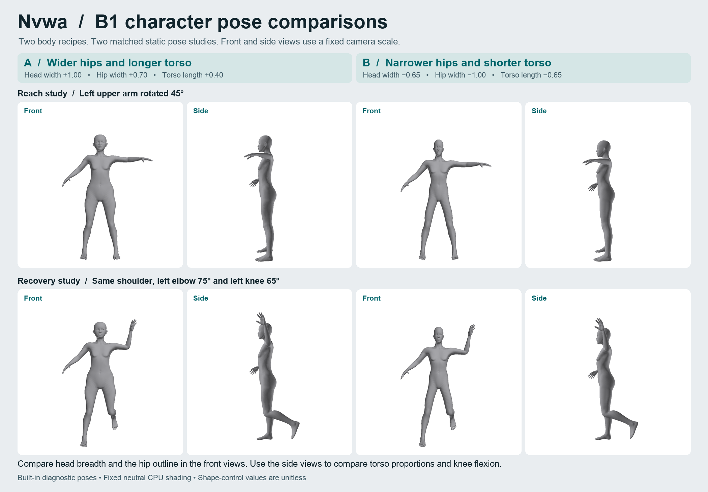

# Game character pose studies

Compare two B1 body shapes in the same side reach and one-leg recovery poses. The front views show head and hip width. The side views show torso proportions and knee flexion.



## Render and edit

From the repository root, build the optional CPU renderer and run the recipe with a fresh output directory of your choice. The script uses Python 3 and the repository's B1 assets.

```sh
cargo build --locked -p nvwa-cli --features cpu-render
python3 docs/examples/game-character/poses/replay.py \
  --cli target/debug/nvwa-cli \
  --output /absolute/path/to/new-pose-studies
```

- `works/` contains two neutral characters and eight editable posed Works.
- `commands/` contains the CLI command batches for those Works.
- `renders/` contains each clean 1024 × 1024 PNG and its render receipt.

Use `nvwa-cli describe-capabilities <work>` to read the current revision. Use `apply` with a fresh command ID and that revision to edit a copy. A `set_parameters` edit keeps the saved pose. A `set_diagnostic_pose` edit keeps the shape and clears any timeline. See the [CLI authoring guide](../../../agents/cli-authoring.md) for the command envelope.

The eight-control B1 profile uses appearance off and scale 1. Character A has head width +1.00, hip width +0.70 and torso length +0.40. Character B uses −0.65, −1.00 and −0.65. The other five controls stay at zero. The recipe uses the built-in `shoulder` and `combined` diagnostics as reach and recovery studies. All eight captures use fixed neutral CPU shading, matching camera settings and a Level 1 body surface. Their scope is static body form and pose.
