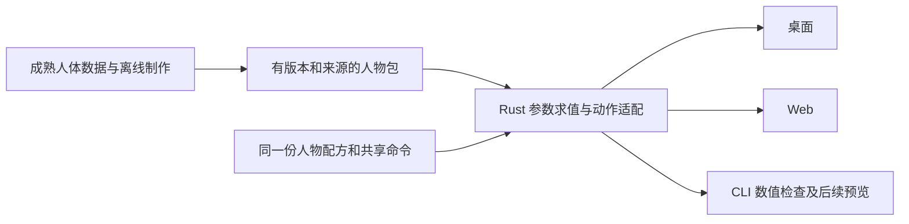

# 人物基础选型：先复用成熟人体，再验证 Rust 执行路径

研究日期：2026-10-16。Nvwa 基线：`1a91178e894bad13bf51223b33b49cf33ea91a1c`。状态：**已进入获准的同样本 A/B 实验；尚未准入新的生产角色**。

当前执行证据见[实验整合入口](../../../experiments/53-character-comparison/README.md)。系统 Blender 已按人的授权升级到 5.2.2 LTS，实际运行 MPFB 2.0.18 的八组身体/骨架/衣物参考；A、B 的最新实测结论以该入口为准。以下分报告保留最初研究时点的发现，不能把历史“未运行”视为当前执行状态。

## 建议先改哪一步

**优先调查成熟方案是对的。下一片应从“继续打磨自制测试人物”改为“验证一个成熟、可分发的人物基础”。** 当前 fixture 继续保留作工程回归，不再默认承担长期人物品质建设。ADR 0003 原本就明确：它是工程输入，没有选定未来生产角色来源；本轮研究不修改这个已接受的决定。[现有决定](../../adr/0003-original-character-fixture.md)

推荐优先验证 **MakeHuman / MPFB 核心数据 + Nvwa Rust 参数执行与创作接口**。用 MPFB 作为离线资产制作和参考计算工具，Nvwa 的桌面、Web、CLI 继续共享 Rust 核心。研究发现 Humentity 等已有 Rust 路线，后续先验证可复用代码，再补实际缺口。不要预先决定把整套人体工具重新实现一遍。

这个建议的主要取舍是：成熟数据能显著减少网格、形变和骨架制作工作，但它不保证符合目标审美，也不保证经过导出后仍保留完整捏人能力。**风格、参数计算、体型后的骨架/服装适配、动作质量和 Web 成本必须分别通过小样。**

## 已经查明的关键问题

| 问题 | 一手资料结论 | 对 Nvwa 的实际影响 |
|---|---|---|
| MakeHuman 是否开源、能否复用人体？ | 是。MakeHuman 代码 AGPL，MPFB 代码 GPL；核心图形数据 CC0。官方明确允许用核心 mesh / targets / system assets 建立自己的生成器。 | 可以优先复用人体数据与成熟设计；代码和可选素材分别核查，不能把全部生态说成 CC0。 |
| 这是不是只提供一个漂亮模型？ | MPFB 有宏/局部形变、随体型定位关节、权重、衣物/proxy 拟合和制作接口。 | 研究对象应包括这套参数关系与数据，不能只拿一个静态导出。 |
| 能否用于纯 agent？ | MPFB 官方有 Blender 后台测试和制作脚本；本轮后续已在本机后台实际执行八组几何参考。 | 离线制作可以使用成熟工具。用户端不必启动 Blender；最终可编辑能力仍需 Rust 执行路径。 |
| VaM 最值得学什么？ | 官方区分外观、姿态、动画与包；morph 有类别、来源、范围和 formula，也明确警告骨骼 morph 与动画通道冲突。 | 学参数目录、状态边界、控制优先级和依赖诊断。其内部体型适配算法仍未知，不据此承诺复制。 |
| agent 是否迫使我们重造人体系统？ | 当前没有这个必要性的证据。现有 Nvwa CLI 已有发现、共享命令和文件创作；缺少更丰富的参数绑定与正式视觉反馈。 | 新增价值放在“能知道、能修改、能看到、能纠正”的闭环。 |
| 成熟方案是否已解决动漫造型？ | MPFB 有官方列出的 cartoon/anime/chibi targets；本轮未下载或检查实际质量。 | 有可验证入口，仍需审美门；不能把写实人体能力等同于任意动漫角色。 |
| 是否有 Rust 现成实现？ | Humentity 公布了 MakeHuman 数据与 Bevy 的运行时方案；OxiHuman 公布了 Rust/Wasm 参数身体生成方案。 | Humentity 已进入实际离线编译与同样本执行；OxiHuman 未执行。是否采用仍由实测准入门决定。 |

依据：[MakeHuman/MPFB 许可](https://static.makehumancommunity.org/about/license.html)、[官方允许另建生成器](https://static.makehumancommunity.org/mpfb/faq/build_other_chargen.html)、[MPFB rig 数据](https://static.makehumancommunity.org/mpfb/developer/rigging_and_posing.html)、[headless 入口](https://github.com/makehumancommunity/mpfb2/blob/3af0cd5a2ffba072e93a34e5f6f494fdc4813ddf/test/README.md)、[VaM Morphs](https://hub.virtamate.com/wiki/person_female_morphs/)、[VaM Animation](https://hub.virtamate.com/wiki/person_animation/)、[cartoon01](https://static.makehumancommunity.org/assets/assetpacks/cartoon01.html)。具体许可范围、版本、未知项与两条 Rust 候选的限制见分报告。

## 复用边界

| 层 | 优先复用 | Nvwa 需要负责 |
|---|---|---|
| 人体内容 | 合法基础网格、局部/体型形变、关节参考、权重、可用服装/皮肤数据 | 逐文件来源、可编辑/可分发范围、目标审美与质量验收 |
| 人体计算 | 成熟的形变组合、关节定位和衣物拟合设计；满足要求的现成实现 | 受限且可版本化的执行、node/mesh 绑定、三端一致性；缺失部分再实现 |
| 创作状态 | 参数配方与分层 preset 的成熟思路 | 同一 Work、共享命令、原子编辑、错误、撤销与迁移 |
| agent 接口 | 延续现有 CLI discovery 与严格命令 | 参数含义/范围/约束、批量候选、测量、实际预览与结果来源 |
| 动作 | 合法动作数据与骨架语义 | 对具体目标 rig 的映射、体型适配、穿插/接触验证；旧 fixture 结论不自动适用 |

图中的新人物包、丰富参数求值和 CLI 预览是提案。当前 CLI 正式范围仍是离线文件创作、发现与校验；不把该图当作已交付功能。

### VaM 设计借鉴与内容复用分开

VaM1 官方说明其人体基于 DAZ Genesis 2。VaM、DAZ 和 Hub 的资源有不同许可，不能因为安装或导出成功就纳入 Nvwa 的开放人物包。这里借鉴公开设计；没有复制 VaM 文件、插件、人体或内置动作，也没有提出兼容任意 VAR/C# 插件的承诺。[官方 Person 说明](https://hub.virtamate.com/threads/09-person-atom-basics.55033/)、[DAZ 许可入口](https://www.daz3d.com/interactive-license-info)、[VaM 资源许可](https://hub.virtamate.com/wiki/license_help/)

### 语义参数是 agent 的主要增量

agent 应能查询“眼距控制什么、范围多少、会影响哪些部件、哪些组合无效”，再通过同一命令批量编辑、保存候选、看固定视角的结果、检查动作并纠正。几何内核无需因此从零重造。

“结合两个人物”也要限定输入。两份同一基础的配方可以先做特征选择/混合；两张参考图到可编辑配方、任意两份网格的对应则是独立能力，本轮没有证明。新参数也不能只把所有底层 morph 暴露成几千个没有说明的滑杆。[当前接口与格式分析](agent-runtime-contract.md)

## 已启动的有界对照与后续准入门

本节是立即实验范围的整合入口。各分报告提供来源与技术要求；其中“同基础两份配方组合成第三份”的 agent 实验属于人物基础通过后的条件阶段，不与本节同时扩大实施。先复用候选；只有记录了实际缺口，才补必要的 Rust 计算。

先完成一个共同的人物样本，再比较两条运行路径。使用同一组参数、参考输出和验收姿势；不以静态好看代替可编辑、可动画。

**共同样本**：固定一个 MPFB 版本、一个基础、一个简单 deform rig、一个合法衣物；制作三个可明显区分的体型/外貌。第一轮少量参数，其中一个体型参数用于暴露骨架适配问题，一个脸部参数用于确认局部控制。动漫 target 作为单独风格候选；不同时扩展到任意角色、毛发物理或房间。

| 路径 | 要回答的问题 | 主要风险 |
|---|---|---|
| A：离线制作并编译小人物包 | 用 GLB + 显式参数/关节 sidecar，能否以最小运行时覆盖这一小组编辑？ | 烘焙会丢掉互斥宏、helper 或拟合关系；不能只切换三个预制模型冒充连续捏人。 |
| B：读取成熟人体数据的 Rust 路径 | Humentity 等现成实现能否直接满足同一数据、体型拟合和 Web/CLI 约束？ | 正确构建、浏览器线程/文件接口、功能依赖、可复现求值与代码/数据来源未验证。 |

MPFB 的[公开维护者答复](https://github.com/makehumancommunity/mpfb2/issues/381#issuecomment-4655951262)建议编辑器考虑源数据格式，并指出大量 targets 互相矛盾/排斥。这是安排 B 的依据，不是直接判定 B 获胜。A 也必须带有明确的编辑规则；普通 GLB 导出不会自动拥有完整捏人系统。

**共同验收门**：

1. 参数中值、端点和一个组合都产生实际可见的连续形变；改变体型后，骨架和衣物的处理有明确结果或拒绝。
2. 与 MPFB 的同配方输出比较顶点、关节与衣物误差；先定义参考坐标与容差。不得只检查 JSON 数值。
3. 同一角色播放抬臂、屈肘、屈膝的合法测试动作，记录正常与失败组合。保留当前真实样本质量 HOLD，不用新角色好看替代旧结论。
4. 相同人物包/配方在 CLI 求值与实际 desktop/Web 中一致，保存交换保留参数与资源身份。数值、画面、性能、真人偏好分别记录。
5. 记录真实包体、构建条件和有限性能；原有 #3 阻塞、#4 缺口保持原状。

只有结果支持时才采用人物基础或第三方 Rust 依赖。若成熟数据质量/风格合格但 runtime 库不合格，优先保留数据并补小执行器；若风格不合格，再评估其他合法基底，不能先扩成新的通用人体引擎。

通过人物基础与参数域的准入后，再按[agent 接口分报告](agent-runtime-contract.md)做固定 rig 的两配方特征组合、预览和纠错闭环。它验证 agent 接口，不代替前面的体型/骨架/衣物门。

**资源门**：固定下载清单已获批准，且人随后授权通过 Homebrew 升级、保留系统 Blender，代替独立 Blender DMG。实际来源与字节见[交付报告](../../../experiments/53-character-comparison/delivery/README.md)。未知后续依赖、其他素材、新模型运行与额外算力仍需另行确认。

## 研究产物与限制

- [开源方案、许可、宏参数/骨架/衣物机制](open-ecosystem.md)：MakeHuman、MPFB、CharMorph、MB-Lab。
- [VaM 公开设计与可借鉴边界](vam-design.md)：Person、morph、动作通道、preset、插件与包。
- [Nvwa 当前接口与 agent 所需增量](agent-runtime-contract.md)：固定源码基线、glTF/VRM、提案与最小闭环。
- [Rust 候选核查](rust-candidates.md)：Humentity、OxiHuman；作者声明与本轮证据分开。

三项分研究由独立 Sol high worker 并行完成，整合负责人补查 Rust 候选并形成此建议。全文仅研究，不修改产品、依赖、资产、历史实验、路线图验收状态或 issue 关闭状态。

**PARTIAL —** 来源与许可已核查，已批准样本及实际离线参考到位，两条 Rust 路径进入实测；桌面/Web 图形、正式 CLI 集成、姿态蒙皮、质量与性能准入仍待验证。
