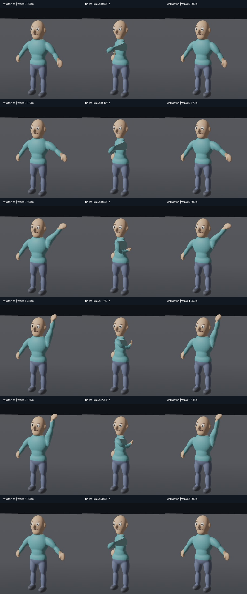

# 40 — Controlled retarget derivatives in the real renderer

Issue [#13](https://github.com/Derek-X-Wang/nvwa/issues/13) passes this bounded visual check. The naive derivative visibly twists the chest and moves the right arm across/in front of the torso. The corrected derivative follows the original overhead wave at all six fixed sample times. Neutral rest renders match. This establishes visual playback for these coordinate-equivalent, equal-topology derivatives; it does not establish a general retargeter.



The contact sheet crops retained runtime screenshots at their original scale. It does not generate poses or replace playback. Complete, unedited window captures with visible paused times remain in `screens/`.

## Inputs and renderer identity

The actual frozen GLBs from experiment 04 were used unchanged. `prepare.py` copied each into the private `.work/m12-retarget/assets/fixtures/` directory. Each Work embeds the exact copied asset hash and actual clip indices, with all appearance parameters zero and scale 1. All three actual GLBs have animation names `[idle, turn, wave]`; wave is index 2. Six retained Works select either the full real wave or an empty timeline for rest.

| Input | SHA-256 |
|---|---|
| Original reference | `f13e0189ae9a1bed17d7cf3e367e495d81ffd31b9a050b76dc1cf2e5bdff6eb6` |
| Existing naive derivative | `3b0cb7255c2ac5586b9925860956a126882dd789717ea3e19f278c3a2f39c2f3` |
| Existing corrected derivative | `425d1628dd3805fb37bbe1b2bbc8ba3cfcab2dd6ae610a59c652a7445c0a7d56` |
| Native release executable | `3be9380f1747c8a6266c59e49f73550e180038fb1259187942af16033a2bc929` |

The executable came from `/Users/derekxwang/Development/incubator/Nvwa/nvwa/dist/Nvwa.app/Contents/MacOS/Nvwa` (existing Oct 11 release artifact). Its byte-identical private copy is `.work/m12-retarget/Nvwa-retarget.app/Contents/MacOS/Nvwa`. **This is an older frozen renderer cohort, not current-main product acceptance.** No native or Wasm compilation ran. No runtime, Studio, dependency, lockfile, original asset, or old experiment file changed.

All variants used this same executable, Player mode, benchmark physical surface 1280×720 at scale factor 1, Metal on Apple M2 Pro, the unchanged production camera and lighting, and zero morph weights. Camera source records position `(3.1, 2.0, 4.8)` looking at `(0, 0.95, 0)`; the executable was not instrumented or rebuilt to alter it. The scene framing in every capture is fixed. No browser or viewport emulation was used.

The native `cua_repl` adapter was verified in this worker before launch. It observed the task-owned app window and actual changing wave motion. All GUI actions used that adapter. `sample-actions.js` records the capture procedure; `ui-samples.json` records the requested exact times. Player Pause was applied before seek. Clicking the numeric value selects its text; BackSpace and type set the value, then Return commits it. The retained full screenshots visibly show Play (paused), Active: wave, Ready, and the corresponding time. An early attempt using Command-A/paste did not set the desired time; those images were overwritten only after the visible value was correct. No unsuccessful input attempt is counted as a sample.

## Observed results

Each of original/reference, naive, and corrected was visually sampled at **0, 0.123, 0.5, 1.25, 2.345, and 3 seconds**. These are six of the 19 original CPU sample times, including two between-keyframe times. There are 18 retained paused wave captures. Wave time zero is an animated pose; the three separate empty-timeline rest controls test the unanimated rest pose.

At 0.5 seconds the reference and corrected right arms rise diagonally. At 1.25 and 2.345 seconds they extend above the head. At 3 seconds they lower together. The naive chest is rotated and its right arm remains displaced near/in front of the torso. This visible failure agrees with the retained hand/joint/vertex errors. The live naive/corrected `live-a` and `live-b` screenshots show changing motion and different displayed times. Renderer-generated wave captures and receipts independently show one active real animation for all three variants. Their automatic capture times are not synchronized and are **not** used for the fixed-time A/B comparison.

`analyze.py` compares only the fixed scene pixels, excluding window chrome, pointer, transport, and other UI. The window captures are 1280×784 including 64 pixels of native frame; the comparison region is `(0,64)` through `(1280,675)`, or 782,080 scene pixels.

| Paused wave time | Naive pixels with any channel delta >8/255 | Corrected pixels with delta >8/255 | Corrected maximum channel delta |
|---:|---:|---:|---:|
| 0 | 8,121 | 0 | 2/255 |
| 0.123 | 8,320 | 0 | 4/255 |
| 0.5 | 8,306 | 0 | 2/255 |
| 1.25 | 8,118 | 0 | 2/255 |
| 2.345 | 8,128 | 0 | 1/255 |
| 3 | 8,210 | 0 | 4/255 |

Across all six samples the corrected image has only 32–260 pixels with any nonzero channel difference. Each naive sample has over 15,000 such pixels. This quantifies these actual screenshots; it is not a geometry tolerance or general perceptual-quality metric.

The separate renderer-generated rest captures have an empty timeline, zero active animations, and a valid loaded skin. Compared with reference, naive and corrected each differ in exactly one scene pixel by one channel level. Their full neutral geometry visibly matches. The rest comparison uses the same scene rectangle relative to the 1280×720 renderer PNG, without the native frame.

Six raw `NVWA_EVIDENCE` receipts independently confirm `ready:true`, `error:null`, 18 joints, 9 meshes/skins, four morph weights, Metal, and 1280×720. The three rest receipts report zero active animations; the three wave receipts report one. These are functional receipts. Their incidental timing fields are **not** a performance benchmark.

## Numerical controls retained and repeated

The unchanged experiment 04 CPU script was rerun into this new directory with bundled Python and numpy 2.3.5. System Python initially lacked numpy; no packages were installed. All 19 exported/reloaded wave samples, 18 joint positions, 24,736 skinned vertices, rest/identity thresholds, source-byte assertion, and four degenerate-input checks passed. Regenerated derivative hashes exactly match the existing derivatives used by the renderer.

| Maximum world-space error | Naive | Corrected |
|---|---:|---:|
| Right hand / all joints | 0.800824139986 m | 2.16774327513e-08 m |
| Skinned vertices | 0.868395833353 m | 3.08111128912e-08 m |

Rest geometry error is `1.39111871227e-15 m`; identity mapping error is `1.51404659356e-08 m`. Full per-sample values and degenerate-error strings remain in `numeric-rerun/metrics.json` and `numeric-run-output.json`.

Supported transformations stay explicit: chest local basis +90° about Y; right upper arm +90° about Z; right forearm +90° about X; right hand +90° about Y. These signed-axis permutations permit exact scale-axis conversion for the fixture's small nonuniform TRS scale terms. Child translations, rest rotations, scale axes, inverse-bind matrices, and animation rotations are consistently converted. Naive and corrected share those target data except for copied versus converted animation rotations. This experiment does not expand support beyond the established signed-axis case.

## Reproduction and retained evidence

From the repository root, prepare and repeat the CPU measurement:

```sh
python3 -B experiments/40-retarget-visual/prepare.py --baseline-app /Users/derekxwang/Development/incubator/Nvwa/nvwa/dist/Nvwa.app
/Users/derekxwang/.cache/codex-runtimes/codex-primary-runtime/dependencies/python/bin/python3 -B experiments/04-retarget-basis/spike.py --out experiments/40-retarget-visual/numeric-rerun
```

With an exclusive GPU slot, launch one task-owned interactive process:

```sh
RUST_LOG=info NVWA_ASSET_ROOT="$PWD/.work/m12-retarget/assets" .work/m12-retarget/Nvwa-retarget.app/Contents/MacOS/Nvwa --player --benchmark --work "$PWD/.work/m12-retarget/works/corrected-wave.nvwa.json"
```

Repeat sequentially for reference and naive. Use the native adapter to pause, type each exact time into the transport, commit it, and retain the full window screenshot. Do not click the character or move the camera. Close/reap the owned process before the next variant. `sample-actions.js` is a replay recipe for the exposed `cua_repl` API; it does not create another UI route or run as a standalone Node script.

The five sequential, self-terminating renderer control commands can be repeated with an exclusive GPU slot:

```sh
python3 -B experiments/40-retarget-visual/run_smokes.py
```

The remaining corrected wave receipt came from the interactive run with `--capture` and without `--smoke`, so it continued for manual exact sampling. `smoke-processes.json` retains the five exact command arrays, PIDs, exit codes, and log paths. `lifecycle.json` records interactive ownership and cleanup. No task-owned renderer remains; the GPU/UI token was returned to the parent before CPU analysis.

To rebuild the pixel comparison, contact sheet, and hash receipt from the retained raw captures:

```sh
/Users/derekxwang/.cache/codex-runtimes/codex-primary-runtime/dependencies/python/bin/python3 -B experiments/40-retarget-visual/analyze.py
```

`SHA256SUMS.json` records each retained file except itself. `preparation.json` records source/copied binary and asset identities plus Work hashes. `visual-metrics.json` retains scene regions, every pixel comparison, and parsed renderer receipts. `issue-13.json` is the issue acceptance text read for this run. `comparison.png` is a convenience crop of actual evidence; `screens/` owns the raw pictures.

## Limits

No different anatomy, bone lengths/proportions, topology, semantic joint mapping, missing joints, arbitrary shear, or unsupported animation form was tested. No general rest-pose transfer, IK, joint constraints, contact preservation, root-motion policy, AI motion, or VaM compatibility is established. No Web renderer, current-main visual acceptance, new build, camera exploration, production-quality character assessment, or performance claim is included. The retained original asset and derivative license remains the existing original-fixture CC0 scope.

VERIFIED — Actual real-skinned wave playback, 18 matching-time captures, three rest renders, six valid Metal renderer receipts, and repeated 19-sample numerical controls. NOT-RUN — Broader rig compatibility and current-main product acceptance.
