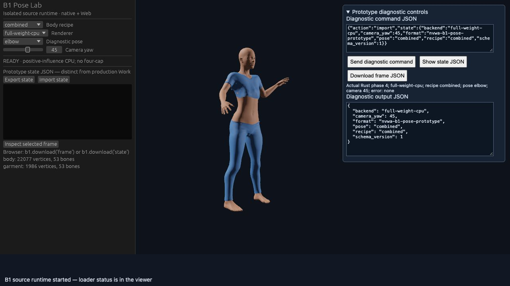

# B1 真实姿态与双端准入

本阶段复用已批准的 MakeHuman/MPFB 人体、运动服及八组配方。没有新增下载、模型运行、额外机器或付费服务。目标是选择可靠的人物后端，不是交付完整捏人产品。

## 已确定的技术结论

1. 现有 Rust 人体库可以实际完成源数据加载、身体/局部脸部形变、关节拟合和衣物拟合。原四权重路径仍然不满足身体误差标准，保留 HOLD。
2. 新的 CPU 桥接使用源数据计算骨骼局部坐标转换，并保留全部正的最终聚合影响权重，不受四权重限制；随后归一化。它是明确修改后的桥接策略，不是原库完整 GPU 蒙皮能力，也不是保留每个有符号原始贡献。
3. MPFB 的衣物权重阈值为 `> 0.001`，桥接为 `> 0`；两者的分布差异和几何误差都保留。身体分布完全一致，衣物最大归一化 L1 差异约 `0.003421`。原四权重中的负权重继续可检查，CPU 显示不使用这些属性。
4. A 的原有身体、关节端点、衣物数值对照再次实际通过。A 没有新增完整骨架、蒙皮或图形能力。

同一组八个配方 × 五个诊断姿态，包含全部 19,158 个身体源顶点、1,797 个衣物源顶点及 53 根骨骼。姿态是明确编写的抬臂、屈肘、屈膝测试，不是 AI 生成动作。

| 检查 | 新 CPU 桥接实测最大误差 | 预先固定标准 |
| --- | ---: | ---: |
| 身体位置分量 | `8.9407e-7 m` | `1e-3 m` |
| 衣物位置分量 | `1.40816e-4 m` | `3e-3 m` |
| 独立候选权重 LBS 复算 | `1.81003e-7 m` | `1e-5 m` |
| 规范化 rest/pose 矩阵分量 | `4.23193e-6` | `1e-4` |
| 关节头位置 | `8.34466e-7 m` | `1e-5 m` |

40 组均通过。完整比较保留身体 helper 和衣物全部源顶点；没有删掉失败顶点或降低标准。法线、切线的数量、维度、有限值、单位长度，以及刚性矩阵、逆绑定和坐标转换恒等式也通过。法线角度、艺术外观和碰撞质量另行验收。

## 运行证据与边界

- [实际 Blender 参考](reference/README.md)：独立生成全部姿态、完整权重和骨架；冻结大数组摘要，原始数组留在任务目录。
- [实际 Rust 运行与修复](../57-b1-pose-runtime/REPORT.md)：保留重复填充权重造成约 90 mm 错误的原始结果、零填充修复、四权重剩余失败，以及新 CPU 桥接的当前二进制完整重跑。
- [桌面/Web 原型](../58-b1-desktop-web/README.md)：两端使用同一 Rust 源码与原始数据编码，运行时计算人物，没有预先烘焙的姿态网格或 GLB 播放替代。
- [可公开复现的固定输入](../59-b1-ci-inputs/README.md)：约 2.14 MB 的已授权源码/数据包，离线提取；CI 参考只取固定顶点样本，不能代替本地完整 40 组准入。
- [A 再运行](a-control-rerun.json)：原有八组数值对照通过；未提升其能力声明。

原生实际运行已暴露并修正默认 tone mapping 配置、CPU 显示网格误带 GPU 蒙皮属性、镜头原点假设及未使用服装遮挡规则。显示只按原始 garment `delete_verts` 隐藏整个已覆盖四边面；完整数值网格不变。诊断姿态仍可见肩/腰穿插及服装折叠，不宣称外观、服装或物理质量合格。

独立审查另外发现了零向量/错误坐标矩阵可能通过、双端比较漏掉身体/衣物，以及相机变化后导出元数据不同步的问题。原始反例保留；修复后已通过拒绝检查和最终双端复查。

最终 native10 / Web06 实际启动、实时选择配方/姿态、六组完整帧对照及双向原型状态交换通过，见[最终采集审计](runtime-evidence/graphics-final-audit.json)与[验收摘要](runtime-evidence/ACCEPTANCE.json)。六组最大位置分量差 `3.57628e-7 m`，矩阵分量差 `8.34465e-7`；覆盖全部 UV 拆分后 22,077 身体顶点、1,986 衣物顶点和 53 根骨骼。普通无效导入完整保留原帧，有效恢复通过；相机变化只更新元数据，没有重新蒙皮。

最终恢复检查发现资产致命失败可被有效导入清掉错误。修复后，原生实际窗口和 Web 各拒绝三类命令并保留最初错误、状态和空帧；原生控件禁用，Web 可见拒绝计数递增。普通输入错误仍可通过有效导入恢复。Web 重新加载后再次成功显示角色。此前同一地址出现过重复加载资产 Fetch 失败；新地址两次加载通过，本地开发服务器明确返回当前文件、禁用缓存后的最终加载通过。**原浏览器失败原因仍 UNKNOWN**；这些观察不证明缓存是唯一根因，也不构成部署可靠性验收。



图像为原始 JPEG 字节。大数组、原生/Wasm 二进制和完整运行日志保留在任务目录；公开摘要包含哈希，图形读回仍是实际 ECS/网格的 CPU 计算，不是 GPU 顶点或像素读回。历史 native09/Web05 的证据保留并与最终 native10/Web06 分开。

## 准入决定

采用正聚合影响 CPU 桥接作为下一阶段接入候选；A 保留数值对照，原四权重 GPU 路径保持 HOLD。本轮只将隔离实验、可复现输入及回归检查归入仓库，不替换产品角色或根依赖。后续 [#74](https://github.com/Derek-X-Wang/nvwa/issues/74) 先接共享命令、CLI 和完整 Work，继续限定同一样本。

修复后的源码与最终图形证据须经过独立审查、精确 PR head CI 和合并后 main CI；这些发布结果在 PR 中按提交记录，不能由本地数值摘要推定。

即使原型通过，也不能据此宣称完整 Work/CLI 接入、连续动作质量、任意人物、宏参数、头发/眼睛/材质、法线角度一致性、无穿插或生产性能已完成。原型状态 JSON 明确不同于正式 Nvwa Work；CPU 数值读回也不同于 GPU 顶点读回或像素一致性。

#3 保持阻塞；#4 保留首帧、完全冷启动和 GPU/总内存等既有缺口；旧 M2 动作质量 HOLD 不变。

复现构建与启动见 [58 README](../58-b1-desktop-web/README.md)。在已准备输入和本地工具的任务 checkout：

```sh
bash experiments/58-b1-desktop-web/build.sh native
bash experiments/58-b1-desktop-web/build.sh web
python3 experiments/58-b1-desktop-web/serve.py --port 9273
```

原生程序位于 `.work/b1-pose-viewer/Nvwa B1 Pose Lab.app`；Web 访问 `http://127.0.0.1:9273/`，需支持 WebGPU。干净 checkout 先按 59 → 57 → 58 的固定输入准备步骤运行，不会下载新资产或 Blender。CLI 证据审计命令 `verify_graphics.py --help` 只核查保留的实际采集，不会启动图形或替代真人验收。

**VERIFIED — 完整 40 组姿态数值、最终六组双端图形进程读回、原型状态双向交换和致命错误保护通过；产品品质及生产 Work 接入未准入，发布 CI 另行记录。**
