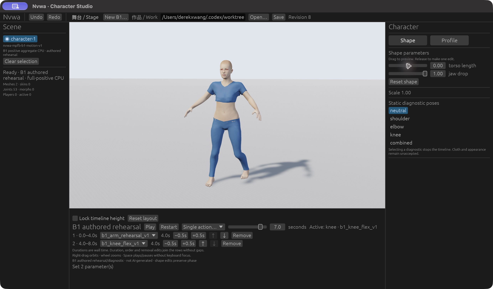

# 原生实际渲染：限定视觉子集

用户解锁且 #78 的原生图形任务结束后，串行启动实验62已构建原生二进制；SHA256 `74106adbcb1ca7fd6b61f361c967e73c04c5aa3fee17e826d3efda57519fc5c8`。用独立 `Nvwa Skin Preview · Experimental` app包装相同程序字节，通过 `NVWA_ASSET_ROOT` 指向本worktree已有资产，`--work`打开固定Web rev7的任务副本。没有改源码或重新编译。

六张原始CUA截图和hash见 [native-observations.json](evidence/native-observations.json)：原始棕色材质→真实皮肤→Restart/Pause手臂2.240秒→普通滑条7秒屈膝、torso0.75改0后皮肤仍可见→同一7秒姿势恢复plain→重新显示皮肤。对照 [原始](evidence/native-screenshots/01-plain.jpg) 与 [皮肤](evidence/native-screenshots/02-skin.jpg)。

原生实验的 `B1_62_COMMAND_FILE` 接受固定动作请求；本轮只提交三次skin/plain切换，播放、暂停、定位、体型由普通GUI真实控件操作。这里**没有原生report/frame导出**；不把请求文件写成功当作绑定验证，也不把Web数值结果冒充新的原生数值读回。截图只建立实际可见纹理和限定操作，不证明原生UV/图像hash或完整geometry before/after一致。

窗口内容没有专用实验切换/状态/not-saved提示，只有独立app身份区分；这个原生入口尚不能作为交付给普通用户的外观界面。原生无效命令/缺资产恢复、完整材质/几何诊断、保存身份与交换、近景质量、像素指标和性能未验证。眼睛/头发未渲染，衣物与M2 HOLD不变。Web完整诊断/失败恢复证据单独保留。

没有点击Save，磁盘Work字节/hash保持起始不变；皮肤不是正式保存数据。已关闭该任务窗口并确认进程退出，保留复制的app、构建与原始截图供复核。原始记录位于本worktree `.work/appearance62/native-gui/`；本报告和图片不进入冻结的编译输入。

PARTIAL — 原生实际渲染和上述视觉操作已观察；不是原生完整功能/质量验收或#79主线准入。
