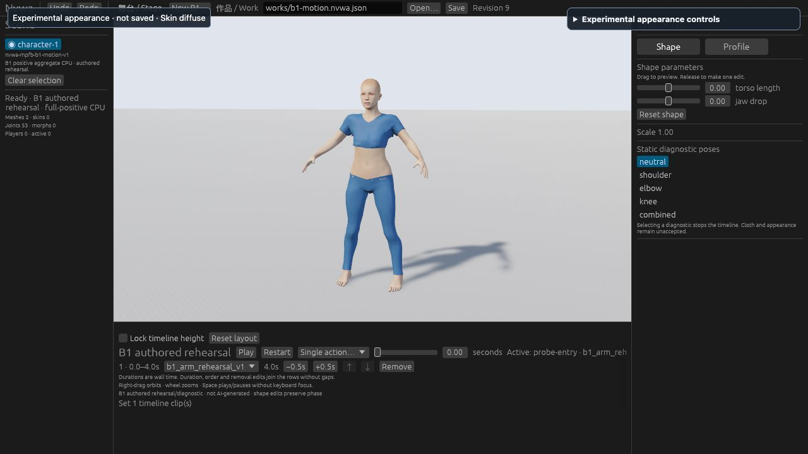

# B1 真实皮肤预览：有界结果

## 结论

复用已批准的 CC0 皮肤，在同一个 B1 人物上显示真实纹理的 Rust/Web 路径已实际跑通。保持现有骨架、体型和动作，没有更换人物或用静态图替代运行时。可以继续用于 #79 的技术准备。

这是隔离实验，不是 #79 主线准入。#78 的原生验收仍需完成；PR #81 保持草稿。衣物质量 HOLD、#3 阻塞、#4 测量缺口及 M2 质量 HOLD 均不变。没有新增下载、模型运行或额外算力。



这是实际 IAB 1280×720/DPR1 截图。截图只证明这个视角可见的纹理与渲染，不证明近景皮肤质量或 GPU 顶点读回。

## 编译、运行、功能和测量分开记录

| 项目 | 实际结果 |
|---|---|
| 资产与捕获服务控制 | 11+9 项 Python 测试；普通与 `-O` 各运行一次，20 项独立测试/40 次执行通过 |
| 首次 Web 编译 | FAIL，E0616/E0596；保留 `evidence/build-r1-failure.json`，未产生可运行导出 |
| 修复后的 Web 编译 | PASS，离线构建15分48秒；独立复审编译修复；41 个导出文件及206 个源码身份有哈希记录 |
| Web 实际启动 | PASS，IAB 实际加载普通 Studio 和真实 B1；所有操作由可见控件/正常 Open 发起 |
| Web 功能 | PASS，纹理/原始材质切换、18 个动作采样、播放/暂停、重复打开、拒绝无效命令、真实缺失资产错误及恢复 |
| 原生编译 | PASS，独立离线编译17分36秒；206个源文件身份与导出二进制哈希全部复核一致，见 `evidence/native-build-receipt.json` |
| 原生实际启动/GUI | NOT-RUN，root 本轮优先 #78；尚未启动 appearance62，编译通过不算 GUI 验收 |
| 性能/内存/GPU 正式测量 | NOT-RUN；此次是调试构建，编译期间的交互不作为性能证据 |
| 主线/Hosted CI | 本实验没有 PR 或 hosted CI 结果；未修改 main。#81 的既有 CI 不转借为本实验 CI |

构建任务：首轮 `run_a6c0f2e8a6e009ea643aa6d873ee2fda`；修复后的 R2 `run_b4cb03d18788bfa64167dcbc129f0639`。每轮独立 disposable target；离线、单 Cargo job。重任务由 wefty 执行。

R2 的实际 ledger 终态为 `succeeded`，起止时间为2026-10-17 23:30:53.393139 UTC至2026-10-18 00:04:37.393017 UTC，总任务约33分44秒。Web 编译日志单独报告15分48秒，原生编译日志单独报告17分36秒；两段编译时间与总任务时长分开记录，均不是产品运行性能。

原生 receipt 的206项源文件哈希与本地当前源文件逐项一致，也与 R2 Web receipt 的源身份完全相同。原生 `studio` 为140,831,152字节，SHA256：`74106adbcb1ca7fd6b61f361c967e73c04c5aa3fee17e826d3efda57519fc5c8`；receipt SHA256：`c670bc3bfdfe98b4c7de8e6ed9d0bc646c1bb351514ff80acdb0c65f819cf48e`。这是原生编译及导出身份的证据，未执行该程序，也不补足外观质量、保存或主线准入门槛。

## 实际技术证据

- 原始拟合 UV 按22,077个渲染顶点的实际重复顺序接入，覆盖19,158个源顶点及2,262个存在 UV 接缝的源顶点。逐项 UV 一致，静置坐标对应最大误差0；没有按源 ID 压平接缝，也没有再次翻转 V。
- UV SHA256：`e601da71ef23211391877289136cc2b5a3e769acffa5d15eb889cb0128e0ca70`。2048² sRGB 实际解码 RGBA SHA256：`ef959fcba8d13ac8bfd07fd2e8051f40ebb72acd5f9852a2a286444042bdb2d4`。
- plain→skin→plain→skin 四个完整生产快照逐项相同。皮肤绑定只改 UV/材质/图像；回到 plain 后恢复原始材质、无 UV、无纹理。
- 18 个实际帧为三个对角体型/下巴组合(-1,-1)/(0,0)/(+1,+1) × 两个已有编排动作 × 0/2/4秒，不是九种体型组合全覆盖。每帧实际快照原样传给 experiment60 的独立 f64 FK/完整 LBS/脚底检查。全部 technical pass；最大 FK 分量误差7.295e-7、关节位置分量误差3.961e-7。此检查不解除衣物质量 HOLD。
- 实际播放从0推进，先观察到0.00690秒；旧证据随播放变为 stale，Store 禁用。暂停后保留3.324298秒完整记录。`live_start` 只有 compact report/界面观察，未声称有完整记录。
- 真正提交无效 Wasm 命令后，错误跨两次观察持续，Store 禁用；没有恢复旧的绿色结果。后续有效报告恢复。
- 用正常 Open 两次打开同一文件，Work SHA256 均为 `62cf2d2b3b5ada7af811a496b66cdfb2b6267791865654d6c3a9327e3256ca8e`，实际新 generation2/3 和不同实体/资产绑定被识别。
- 仅临时移走本轮导出站点的 manifest 副本，再用正常 Open 打开同一有效 Work，产生真实 HTTP404。原人物/作品保留，当前报告显示失败，Store 禁用。恢复副本原字节后正常 Open 成功，generation4；所有41个导出文件重新核对哈希一致。源资产未改动。
- 一个 Store 工具调用超时发生在动作已落地后。以随后真实界面 receipt 确认唯一成功文件，没有重试覆盖；见 observations 中的 toolNote。

## 尚未证明什么

全身视角可以看到皮肤、眉毛和身体纹理，但尚未验收脸/颈近景、接缝审美、灯光下的肤质或不同材质效果。衣物肩、腋和腿部的折叠/穿插仍可见。眼睛和 short04 头发仅完成来源/解包/解码验证，未拟合或渲染。

临时皮肤明确显示 `Experimental appearance · not saved`；此次没有把外观写入 Work。正式保存身份、桌面/Web 外观交换、眼球控制、头发权重/alpha、GPU 读回及性能均不能从本轮推定通过。

九张原始截图见 `evidence/screenshots/`。无效命令与真实 Open 失败画面中，底部可能显示此前已存储记录的历史 receipt；当前报告和 Store 状态为失败/禁用，不把历史 receipt 当作当前成功。

## 复现与原始证据

构建和运行命令见 [README.md](README.md)。先运行资产/捕获服务测试，再用已有依赖离线构建；启动后用 DOM 实验控件完成 plain/skin 切换，按 `build/cases.json` 逐项采样并存储，用正常产品 Open 验证同一 Work 重开。数值检查命令：

```sh
python3 -B experiments/62-b1-appearance-preview/build/check_captures.py \
  --captures "$NVWA_EXCLUSIVE_CAPTURES" --asset-root assets \
  --out "$NVWA_EXCLUSIVE_CHECK_OUT"
```

本轮未修改用户常用页面、未点击 Save 或下载到 Downloads。测试临时页及专用9277服务已关闭。原始27个完整 JSON、构建日志与导出保留在此 worktree 的 `.work/appearance62/`；原始记录289,990,153字节（约290MB），不进入 Git。Git 中保留全部27个记录的字节/哈希、18项检查结果、compact reports、事件、Web构建receipt、九张截图。不是声称只凭哈希就能复现原始帧。

独立审查见 [SOURCE-REVIEW.md](SOURCE-REVIEW.md)。建议接下来先补原生实际画面验收；通过 #78 后再决定 #79 正式外观准入，并逐项做眼睛/头发适配，保留原始材质对照。

PARTIAL — Web 真实皮肤/UV、18项独立数值检查、失败恢复及独立审查通过；原生 GUI、正式保存、眼睛/头发、近景质量、性能和主线准入尚未通过。
