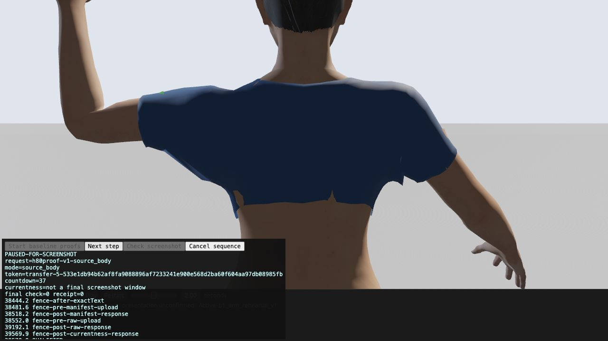
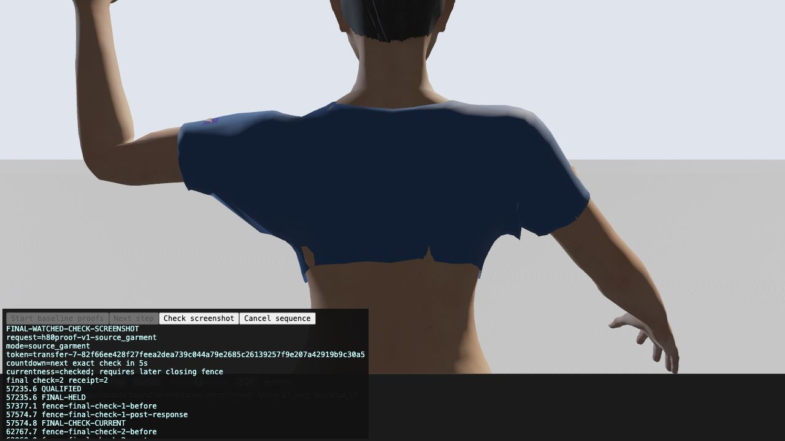
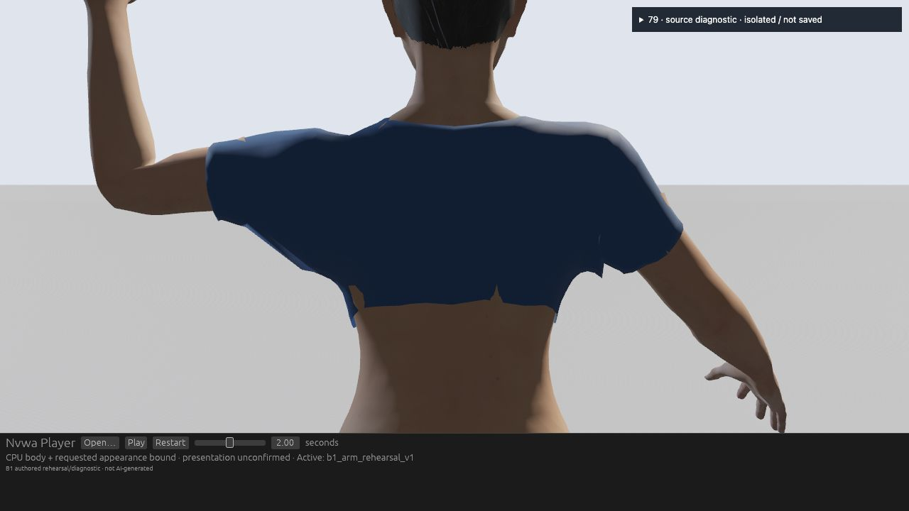

# Visible shoulder source and one-point corrective — 2026-10-19

**Decision: retain the source diagnosis; reject this one-point correction.** The product character and its existing full-positive CPU skinning remain unchanged. #80 and #79 quality HOLD remain open; #3 stays blocked and #4 retains its measurement gaps.

## What actually ran

| Layer | Observation |
| --- | --- |
| Native compilation / CPU |12 Rust CPU/ECS tests passed; actual wrong first-swap bounds and UV-only mutations were first caught red, then fixed. Ordinary native GUI was not run. |
| Web compilation |Offline Wasm build succeeded in12m38s; bindgen0.2.129. Wasm143,760,706bytes/SHA29da8e1a3a2926206c06b03ed6bd77429f681e2ce58515b6262effcd8f2bd8ec. This is build duration/size, not app performance. |
| Actual source Web run |Three full1280×720 held-arm2 captures: unchanged combined, body7941 green, garment131 magenta. Stable counts2; epochs25/712/853. Original exact raw strings, independent IDs, Work, camera, full geometry, same-update publication witnesses and screenshot fences passed independent review. |
| Actual corrective Web run |Fresh page32 rebuilt all three same-page proofs before authoring the exact frozen target. Reused proof ID strings are explicitly scoped to this new page, not inherited from closed31. Baseline epoch2030; source proofs4652/4756; author5098; corrective5826, stable2, weight1. Real UI controls and real browser downloads were used. |
| CLI |Actual Web Work→validate→save→validate all exited0;3548bytes remained identical, SHA0098c768ddeb3812a8c12a66772868b1c46eb06d219640d9b6049a0aa004f316. Transient diagnostics/corrective are not saved Work capabilities. |

Full raw/source/build packages, failures and receipts remain local. The public [observations](evidence/observations.json) identify them; hashes are not public raw or GPU proof. Hosted PR/main CI is recorded in the PR after it runs, not inferred from these local checks.

## Actual visible source

Original body quad7941 maps to displayed triangles13660/13661; garment quad131 maps to262/263. The full original OBJ topology, existing body mask and authored bone data agree. At pixel center340.5/196.5, independently reconstructed actual CPU camera rays hit body13661 at0.98147114015m and garment263 at0.98295288627m. This approximately1.482mm camera-ray ordering is not a penetration depth or authoring vector. Of400 fixed ROI pixel centers,44 are body-first:43 on body7941, one on adjacent7983. These are CPU visibility probes, not GPU pixel counts.

The actual green source color occupies the skin notch. The garment color occupies its adjacent ridge. Combined with unchanged displayed triangle positions and same-update mesh bindings, this establishes source correspondence. No body deletion, alpha policy, material, depth bias, camera hiding or weight pruning was used. Source colors are diagnostic only. GPU object-ID/depth readback was not run.

## One authored vector, then rejection

The target was derived once after the source proof passed independent review. Source847's nearest body fan13661 has signed local planar-side separation−0.314422mm and source-winding/interpolated-normal dot0.937646>0. The fixed1mm margin rule yields a1.314422mm delta. This is local planar-side authoring, not global inside/outside. The posed clavicle maps the frozen vector back with an independent6.39e-11m error. The exact399-byte target SHA isf88a431ab6dfb2da3bd9a64852f0c490bafe29b21a86e86b98d063862ad00b51. No second support, vector, tuning pass or threshold change was attempted.

Actual uploaded corrected positions change only render vertex232/source847, with exact f32 addition and unchanged positions elsewhere. Body, original full-base reference, Work, camera, materials, topology, UV, tangent and culling policy remain unchanged. The little skin fleck remains visible. Actual normal hashes bind before/after visibility; frozen source limits normal writes to seven incident source IDs. A separate array of actual corrected normals was not exported, so independent per-normal readback is NOT-RUN.

The fixed19-case analysis separates18 full historical actual baseline inputs from one new actual default input. Nine neutral/knee/end controls remain exactly zero. No new degeneracy/winding inversion/self-crossing or fixed body-probe exposure regression was found. But10 raised-arm cases fail the frozen no-new-proper-crossing-pair gate. In the fresh default, fixed body-first ROI centers improve44→24, fixed body-surface probes8→4, and local proper cloth/body pairs8→4. A new pair appears: garment240/body13661. Independent line-plane/Gram tests on the **actual Web corrected positions** confirm two strict interior crossings, with edge fractions0.2066724/0.4619005, while baseline has none for that pair.

This is robust new-pair/pair-migration evidence. It does not prove total collision worsened, and the lower total count does not waive the frozen no-new-pair condition. The result is **REJECT**. It does not justify changing global fit/full-positive weights or masking the body. Broader cloth physics and overall appearance are outside this experiment.

## Failures preserved and verification limits

The first obsolete native snapshot failed on a copied missing eye source-map include; it was not promoted. A later real CPU test run exposed five first-publication/UV failures. Corrected final Rust passes12 tests. One intermediate green run was canceled after an output-directory ownership mistake; the final build used a separately seeded exclusive target after cancellation was terminal. Logs and source closures distinguish these versions.

Offline authoring initially accepted internally consistent publications with a wrong outer camera/generation/Work/parts and a nonorthogonal bone matrix. Real red controls preceded strict outer bindings and affine/orthonormal/rotation checks. A later cross-baseline whole-buffer AABB assumption rejected valid deindexing: the body had9464 unreferenced original vertices. It was replaced with exact own-buffer bounds plus unchanged displayed triangles; unchanged roles/materials/policies stay exact. Both the original failure and later true AABB mutation rejection remain retained. The source verifier's first indexed-only assumption likewise rejected real deindexed captures; only the selected diagnostic role now permits that exact nonindexed layout. These tool compatibility fixes do not relax the corrective quality gate.

The browser helper's final stale-token failure was reproduced and fixed. Final checks revoke stale status and close the bounded screenshot window; actual three-source run closed at check12/event76 with no stale/cancel/failure. Manual page2 controls succeeded. A UI-summary role lookup and a200,000-character tool return limit caused retained automation errors; native AX retargeting and read-only DOM chunking recovered without app/source changes or truncated raw acceptance.

Reproduction and control commands are in [README](README.md). Portable controls use synthetic fixtures; source, geometry, actual Web upload, image and CI evidence remain separate. Normal/tangent shading quality, complete collision/coplanar contact, all parameter combinations, ordinary desktop GUI and GPU presentation/performance are not certified. No new download, model run, paid API or extra machine was used.
