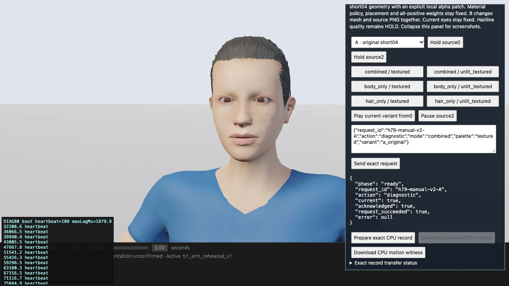
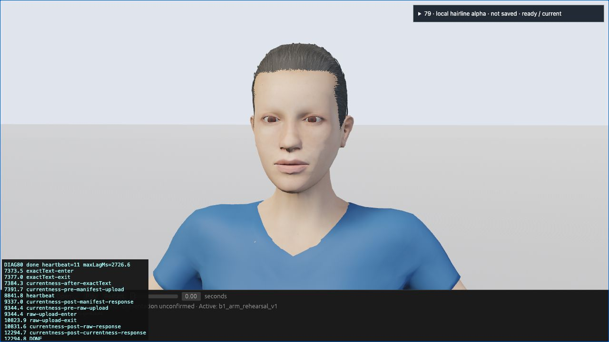

# Issue79 export diagnosis — one original A recovered

VERIFIED — the HTML automatic path preserved one actual current original-A record and passed the unchanged single-capture source/CPU validator. The manual browser-automation timeout remains reproducible. Its underlying cause is UNKNOWN. Hair quality remains HOLD; B, A→B→A and the full cohort were not run.

The actual screenshots below show the approved existing CC0 character. They verify the observed page state, not hairline quality. Full raw/source evidence remains local; its identity is recorded in [observations.json](evidence/observations.json).

## Actual differential result (root browser observer)

Both runs use the same frozen v2 instrumented page, original R2 Wasm/assets/Work, full1280×720 scene and unchanged transfer core. Manual mode sends no automatic app commands. Only explicit `case=fixed-auto` sends the fixed paused-source0 A sequence.

Manual tab29: A was ready/current/acknowledged/successful. Native AX click failed stale/missing after2800ms; exact Playwright role click hit Runtime.evaluate timeout after4163ms.28 server events contain no `manual-prepare-enter` or digest event, while heartbeat continued. This is a delivery failure before observed handler entry; it does not establish a transfer-handler failure. Receipt/image/events are retained in the private local evidence bundle.

Fresh auto tab30: actual committed Work matched the independent pin before any command, then original Send→held source0→current successful A→stable2/current identity→original transfer.prepare→exactText succeeded.33 events end in DONE with post-response-current. The saved currentness receipt retains six before/after fences through raw response; an additional event fences the currentness response. Token:
`transfer-3-d79f44812cd6b840bd8d4f15d71b9f4d886ccc05bce062ea5be5232916c6f4d2`.

Raw request `h79e80-auto-v2-A`:14,258,670 bytes, SHA256`d79f44812cd6b840bd8d4f15d71b9f4d886ccc05bce062ea5be5232916c6f4d2`. Original report161,308 bytes/SHA`34dfc46faa5debad73eece5a42235d14d230a42b950c780d452ab7a1d9fa759a`; frame14,097,342 bytes/SHA`fab99792b9412411edd5a40a650679bde411648dd2bf0cf7456fb47db6d75263`. Exact original substrings are retained separately without JSON re-encoding. Actual JPEG and AX show original A plus DONE/current status. The12,294.8ms sequence and117.3ms prepare interval are diagnostic breadcrumbs, not formal performance measurements.

## Independent single-capture verification

Restored exact R2 source310 plus recorded69 RESULTS supplement into a new validator-root (311 files, all hashes checked). With root's independent expected ID, unchanged `collect_transfer.verify_bytes` and unchanged `check_captures.validate` passed. Source/body/garment/full-positive influences/authored bones/hair fitting/binding/image/camera checks retain their original limits. Replay errors: position0, normals2.7364758848930516e-15, UV0. This is single-A source/CPU proof, not GPU pixel scoring or a quality comparison.

## Interpretation and retained controls

The strongest current result separates manual tool delivery from page-driven export. The unchanged transfer can succeed for this case. Continuing heartbeats and successful auto export contradict a permanently frozen app or universally broken prepare path. They do not identify why manual DOM/AX resolution timed out, or exclude intermittent main-thread load. No Rust checks, update cadence, image/material/scene/viewport or stale/mutation gates were changed.

V1's21 direct tests missed HTTP Handler construction. Root found a connection reset; a new real loopback test reproduced the same unset-self.server error before the v2 fix. V1 source/failure and an initial test-only error remain retained. V2 uses the explicitly passed server and adds real committed-Work startup waiting.22 CPU tests pass, including real HTTP GET/HEAD/config and complete manifest/raw/currentness POST, hostile-origin/Host/create-only rejection and original transfer readiness/cancel/overlap/stale controls. Original transfer core SHA remains44698bd8f212ae656ccf6561b277ceb3bb4e9f01bbf9d51d1ceb3f318dbeab9a. Source freeze v2 SHA`dfc5e24ae4577861c9f0ab46a14cf9caaf46715238d84addefeee41278d2e65a` remained exact through the actual runs.

Worker had no eligible IAB and did CPU/HTML work only. Root owned both actual browser runs and GPU throughout; root receipts confirm both tabs closed. Worker integration-test sockets were ephemeral and closed. No B/cohort, Rust build, Git operation, external write, model/download, production-source change or sealed-old-artifact mutation occurred. Reproduction commands are in README.md; raw/source validation log is VALIDATE-A-v2.log. Future cases need their own frozen inputs and actual evidence.

## Final portable guard verification

The final test suite passes all26 checks under normal Python and `-O` from a minimal copy containing only this experiment, without `.work/`. Root repeated the complete26 checks in the isolated integration checkout. These portable guard fixtures remain separate from the actual311-file source/CPU validation. The observed runtime v2 bytes were unchanged by the later generator/wrapper/test portability fixes.
