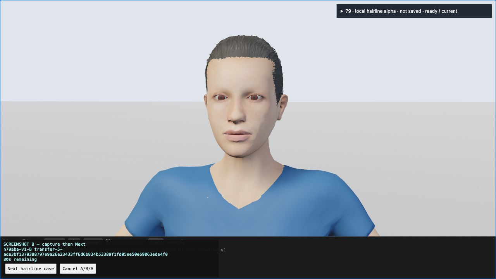
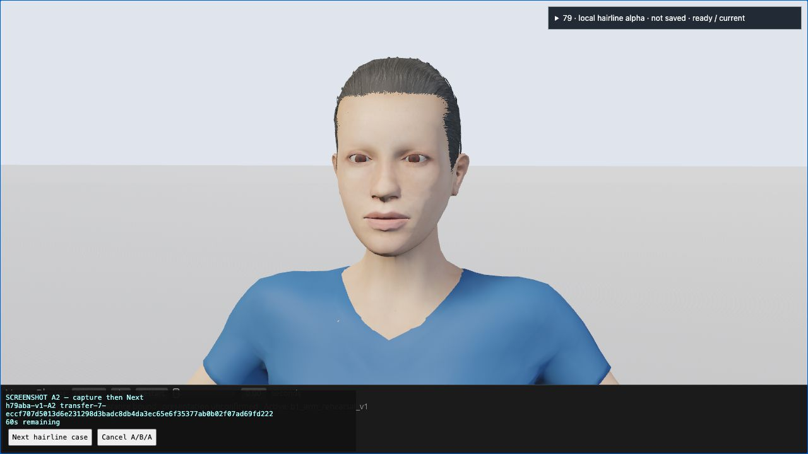

# One actual A → B → A completed; quality remains HOLD

VERIFIED — one same-scene Web A/B/A produced three exact current records and three qualified1280×720 screenshots. Original source/CPU validation, original cross-control statements, A1/A2 restoration and historical-A semantic comparison passed. Independent image judgment recommends RETAIN A and NO cohort expansion. Current B benefit is insufficient: this group is INCONCLUSIVE / NO-ADOPT and overall #79 remains HOLD. Full cohort and native paired images remain NOT-RUN; no hair quality admission follows from transport success.

The root observer ran the frozen chain once on2026-10-19PDT (2026-10-20UTC), in fresh IAB tab33. The original retained Wasm, assets, `default-arms` Work, paused source0, Combined/Textured view, materials, camera and canvas dimensions stayed fixed. Commands selected original A, local-alpha B, then original A. B is the existing temporary #78 local-alpha variant; it is not experiment69's rejected mip candidate and it was not saved into the Work.

## Actual paired images

These are byte-exact copies of the approved existing CC0 character screenshots. Each capture interval falls strictly after a successful post-currentness-response opening and before its later exact closing fence. Request/token state was visible in each screenshot. Images establish the observed view and interval; they do not supply GPU object-ID/depth evidence or pixel scoring.

A1 — `h79aba-v1-A1`

B — `h79aba-v1-B`

A2 — `h79aba-v1-A2`

## Independent quality judgment

At1280×720, current B shows a subtle boundary change, while the abrupt/jagged hairline remains. Review found no convincing practical gain, so retain A and do not expand the cohort. No new forehead or eye occlusion was seen in this source0 view. This result applies to the current #78 `BLocalAlpha` patch only. Earlier #76 fringe-B occlusion failures concern a different candidate and are not evidence against this patch. Other poses, the full cohort and GPU pixel scoring remain untested. The current group is INCONCLUSIVE / NO-ADOPT because benefit is insufficient; overall #79 remains HOLD.

## Exact records and source checks

| Case | Actual raw bytes | Raw SHA256 |
| --- | ---: | --- |
| A1 |14,258,662|`6d2167c15ba2b27681464aa2597155de6f9e59049277a35166f1d8a9ff843ab0`|
| B |14,258,664|`ade3bf1370388797e9a26e23433ff6d6b834b53389f1fd05ee50e69063ede4f0`|
| A2 |14,258,662|`eccf707d5013d6e231298d3badc8db4da3ec65e6f35377ab0b02f07ad69fd222`|

Tokens use original transfer epochs3,5,7 respectively with the corresponding raw SHA. Original report/frame substrings and their hashes remain exact; no parsed numeric witness was re-encoded. Full report/frame byte counts, hashes, image hashes and timestamps are in [observations.json](evidence/observations.json). Raw records and the private source capsule stay local. All94 actual receiver files were checked byte-for-byte against root's retained copy.

All three captures passed unchanged `check_captures.validate` from the authenticated311-file source capsule. Maximum replay errors per capture were position0, normals2.7364758848930516e-15 and UV0. The original cross-control group statements were executed verbatim for A1/B and B/A2, retaining same-scene body, bones, appearance, camera, environment, non-hair buffers, alpha-only hair geometry/source arrays and material/image-policy/placement checks. This is a bounded comparison; the full original matrix was not run or claimed.

A1/A2 restoration passed for the entire parsed envelope except exactly `report.request_id`, `frame.request_id` and `frame.stable_updates`. No same-page entity, handle, generation, serial, publication, camera or source field was excluded. A1 also passed the predeclared historical semantic/source projection against the prior actual A whose raw SHA is `d79f44812cd6b840bd8d4f15d71b9f4d886ccc05bce062ea5be5232916c6f4d2`. That historical projection permits explicitly listed fresh page-local resource and publication identities; it does not assume historical handles or epochs repeat. The projection and limits were frozen before this run and are listed in [README.md](README.md).

## Currentness and finite close

| Case | Qualified opening UTC | Screenshot UTC interval | Exact close UTC |
| --- | --- | --- | --- |
| A1 |04:33:08.316|04:33:24.187–04:33:26.621|04:34:10.937|
| B |04:34:20.754|04:34:29.930–04:34:32.316|04:35:20.858|
| A2 |04:35:31.091|04:35:59.635–04:36:01.644|04:36:36.096|

All times are2026-10-20UTC. The explicit `pace=60` path advanced automatically through the bounded windows. Every case retained the six original named currentness fences through prepare/exactText and manifest/raw responses, plus the currentness-response fence. Every window closed with exact report/frame/token rechecks and a successful post-close-response fence. The final close invalidated the transfer token, stopped the watch timer and disabled Next. Root later observed `DONE — closed; no live screenshot proof`. DONE is outside the qualified image interval. Timing here is correlation evidence, not a performance measurement.

## CLI, controls and retained source

Root exercised the existing CLI against the actual exported Work: asset-aware validate, save, then asset-aware validate of the saved Work. All exited0. The original and saved Work are byte-exact3,540-byte files, SHA256 `17b83a2fd7762725dfa969774540ad30d39b413d4ac306096cb7a6cb4d0426fb`. This proves Work exchange for the held recipe; it does not persist the temporary diagnostic B variant.

The21 portable tests passed under normal Python and `-O`, including actual ephemeral HTTP lifecycle tests and called JavaScript readiness/request/variant/stability/cancel/overlap/stale/network/window/final-stop controls. These explicit synthetic fixtures remain separate from the three actual records and unchanged source validation. No harness rerun was made for this publication update.

Observed-runtime freeze SHA `f9b0f757c782297b3bc79125ab6240c7efa3e74f2405dbb95877de5fa50a4054` stayed exact through the actual run. Original transfer-core SHA remains `44698bd8f212ae656ccf6561b277ceb3bb4e9f01bbf9d51d1ceb3f318dbeab9a`. Before this report, the exact15-file public source snapshot was copied and authenticated under ignored `frozen-actual-v2/source`. Publication changes only README prose and adds this report plus exact JPEG/JSON evidence; controller, receiver, validator, generator, contract and tests remain unchanged.

The root closed the actual page and server. Worker ephemeral test servers were already stopped. Authenticated inputs, frozen source, raw captures, receipts and logs remain local for review and retention. The integration adds the portable controls to the existing CI loop, preserving prior gates and time limits. No new model run, download or Rust build was performed. Product source, root dependencies, lockfiles and historical experiments remain unchanged.

PARTIAL — transport, bounded source/CPU comparison, screenshot currentness and CLI exchange are verified. Independent image review recommends retaining A; broader quality across the wider cohort and GPU pixel scoring are not established here. Routine desktop acceptance remains NOT-RUN under the current policy; A remains the production baseline and hairline quality remains HOLD.
