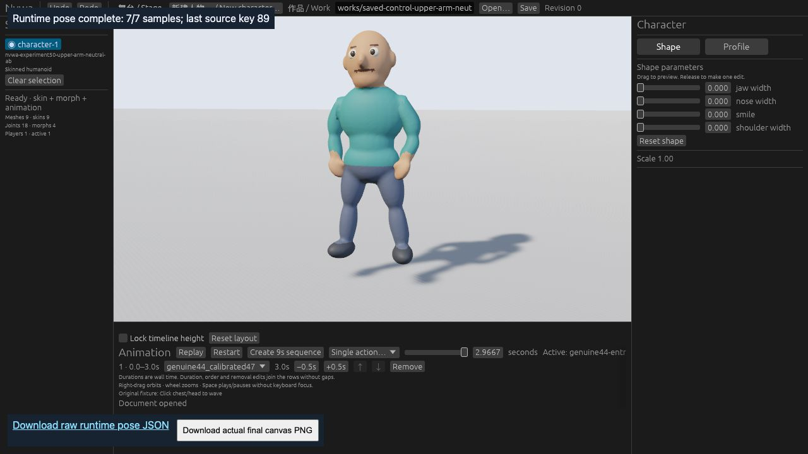

# 88 - one fixed local chest candidate

**HOLD / NO-ADOPT: no compelling visible shoulder gain.** The single frozen candidate passed offline preservation/mechanism and actual CLI save/reload. Actual Web completed the same seven keys for both variants, but independent key89 image review found insufficient perceptual benefit. Stop here; no strength adjustment, candidate retry or capture-framework expansion.

This is the early original GLB fixture and retained genuine44 motion, not B1. The operation uses a spare arm-side slot for chest, retaining both original positive influences. It changes 42 arm records inside the unchanged 96-vertex maximum region. The ceiling remains 0.5 with the frozen 20 mm rest-position taper. No runtime, bone, slot count, geometry, normal, motion or region changes. [PROPOSAL.md](PROPOSAL.md) is the unchanged pre-run contract; it was not rewritten after execution.

## Actual results

| Check | Observed result |
| --- | --- |
| Synthetic controls | 11 cases pass in normal and `-O`, independently rerun |
| Real construction | One call, exit 0, 0.408 s; 30 s hard stop |
| Offline evaluation | One attempt, exit 0, 9.311 s; 240 s hard stop |
| Preservation | 452 changed bytes inside 42 permitted records; old positive influences retained; discard 0; maximum normalization error 5.061e-8 |
| Motion | All 90 local/global poses unchanged; old50 exact identity gate retained and passed on old50 |
| Key89 edge 6497-6508 | 68.360 to 47.020 mm |
| Key89 edge 8998-9001 | 64.612 to 41.866 mm |
| Same39 edge maximum at89 | 68.564 to 51.292 mm |
| Original surface analysis | Crossing counts unchanged at all seven keys; old failures remain |
| Surface coverage | Right-arm partition loses 49 faces (3958 to 3909); no penetration-improvement claim |
| Current CLI | Build 23.516 s; all 10 validate/inspect/save/reload calls pass |
| Current-source Web | One offline/locked local build 55.61 s; pinned bindgen; both actual seven-key captures complete |
| Visual acceptance | INCONCLUSIVE GAIN / HOLD / NO-ADOPT |

The candidate GLB is `94b2e45c90f932d2e337ca76f4c5933dcb288ff0d78ca30a23484edb0be1c3b4`; Work is `3ef60a73904967be508f839a94f708bf3d0cf611489de76d7a06afd33ce8b478`. Retained [construction](evidence/construction.json), [offline result](evidence/offline.json), [fixed geometry](evidence/fixed-geometry.json), [membership](evidence/surface-membership.json) and [independent visual review](evidence/web-visual-review.md) separate mechanism from appearance.

## Actual same-key Web pair

Both views use one in-app-browser tab, 1280x720, the same saved white-studio camera/stage and paused key89 at binary32 time 2.9666666984558105. Raw [control](evidence/control-runtime.json) and [candidate](evidence/candidate-runtime.json) records contain keys 0/15/30/45/60/75/89, correct clip/index/time/pause/weight and equal node/skin/stage records. These records do not contain GPU-deformed surface positions or normals.

Control:



Candidate:


The physical-left cap is image-right. It still looks raised/angular in both views; there is no compelling gain at this scale. No gross new silhouette failure was seen, which does not certify local crease, volume or shading quality. Images are original JPEG screenshot bytes, not lossless pixel-equivalence evidence. Task-local originals had `.png` filenames; these `.jpg` copies preserve exactly the same bytes.

An authenticated key0 screenshot pair is NOT-RUN. A UI seek reached 0.50 seconds; its images were excluded. A crop API returned the wrong origin; that image was also excluded. No further capture was attempted to rescue the candidate after key89 failed the visual-gain rule. Native UI is deferred by policy. Between-key quality, detailed normals/shading, contacts, anatomy and full M2 quality remain unverified/HOLD.

## Reproduction and scope

The following synthetic controls are safe to repeat; they never construct the real fixture:

```sh
python3 -B experiments/88-m2-chest-local/test_controls.py
python3 -B -O experiments/88-m2-chest-local/test_controls.py
```

The one historical construction and offline commands were `candidate.py --output experiments/88-m2-chest-local/evidence/construction.json` and `evaluate.py --output experiments/88-m2-chest-local/evidence`. Receipts already exist and the constructor refuses existing outputs. Do not delete those outputs to retry or tune. Full raw command/build/CLI logs and saved Works remain in the task work product; public evidence includes original source IDs, results and actual runtime captures.

`probe/` copies the existing50 runtime probe. Its sole source delta admits the exact88 profile identity; dependencies, lockfile, seven keys, capture checks and hold89 are unchanged. Original50 sources/gates are untouched. The build used cached dependencies only; no model or asset download and no inference. Preserve the original fixture and generated-motion provenance/terms retained with experiments41-50; no new composite CC0 claim is made.

The test tab/server and per-run build target were closed/removed after retaining evidence. No PR, production adoption, main change or CI run is part of this negative-result archive. #79 current A/download approval boundary, #80 HOLD/99-point backup/full21 prerequisite, #112 original failure, #3 blocked and #4 gaps remain unchanged.

PARTIAL - offline mechanism, actual CLI and seven-key Web runtime verified; visible benefit not established, so candidate is not adopted. No further candidate work is authorized by this archive.
