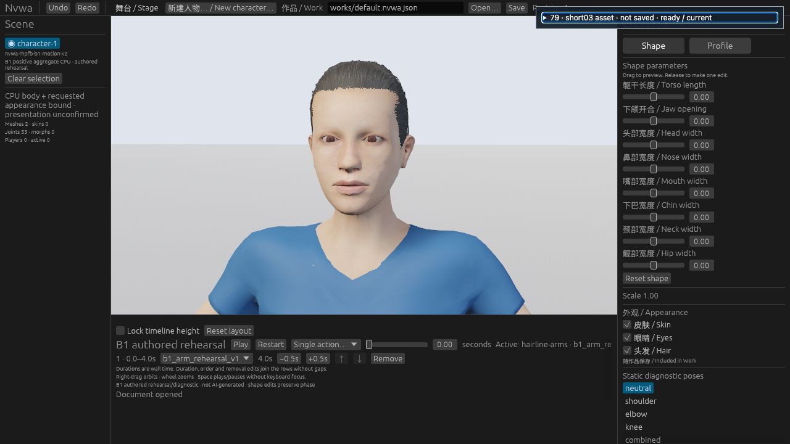
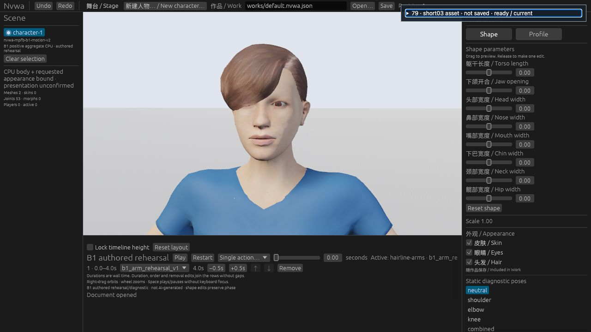

# #79 short03 replacement pilot: STOP / NO-ADOPT

2026-10-24. One independent short03 candidate was imported and rendered through the existing full-positive B1 path. **Technical A/B/A passed. Visual improvement did not pass the one-shot continuation rule. Keep production short04.** No product source, dependency, CI gate or accepted Work asset identity changed.

## What this established

- The authenticated short03 source imports as 1,011 source vertices, 1,071 position/UV render corners and 1,922 triangles. Signed MHCLO fitting, one-time unit conversion, recomputed normals and all final-positive influences over the existing 53 bones work with this asset. Five positive influences are retained where present; no four-slot truncation was introduced.
- Original PNG pixels pass through the existing `simple-srgb-mask-v1` strategy: sRGB, `Mask(0.5)`, roughness 0.7, double-sided/no culling. The legacy litsphere shader is not acquired or reproduced. Source files, pack metadata and hashes are in [SOURCE.json](SOURCE.json); the original headers and [CC0 text](candidate/short03/CC0-1.0.txt) are retained.
- Actual Web source0 records pass authenticated source-specific CPU replay, upload/image bindings, exact non-asset state comparison and exact A restoration. Only request identity and stable-update count are excluded from A1/A2 equality. Body, eyes, clothing, Work, bones, camera, stage, material and image policy remain compared.
- These arithmetic and identity checks do **not** establish scalp contact, hidden intersections or artistic intent.

## Single Web comparison

The existing page/controller performed A original short04 → B short03 → A original short04. All three were held at source0 using the default Work, fixed camera/stage, 1280×720 viewport and Combined/Textured display. Exact transfer manifests and the original raw JSON were retained. The controller, material and candidate remained frozen throughout. Mouse/DOM actions intermittently timed out; ordinary keyboard focus and activation completed the same existing controls. No bridge or capture framework was added.

| A: original short04 | B: independent short03 |
| --- | --- |
|  |  |

B has a smoother swept silhouette. Its fringe also covers the viewer-left eye and eyebrow and much of that forehead/temple. A leaves both eyes visible. This is not an obvious overall improvement without regression for the requested replacement test. Hiding the frontal scalp boundary cannot establish a repaired hairline. The exposed B edge shows no obvious floating gap at this view size, but hidden/back contact remains unknown.

The independent cross-model reviewer reached the same **NO-GO / STOP-HOLD** conclusion. This is a rejection of promotion as the current replacement, not a claim that the source hair is defective or that a fringe style can never be useful. No human aesthetic preference was measured.

## Verification actually run

| Scope | Result | Time / limit |
| --- | --- | --- |
| Python source/isolation controls, normal | 9 passed | 128.016 s / 240 s |
| Same controls, `-O` | 9 passed | 127.236 s / 240 s |
| Actual Rust `candidate::source_tests` | 5 passed; 20 other Rust tests filtered, not run | tests 0.15 s; Cargo 8m36s; wrapper 521.747 s / 20 min |
| Wasm compilation | PASS | Cargo 53.22 s; wrapper 58.331 s / 10 min |
| Web actual A/B/A | three ready/current exact records | one default source0 sequence |
| Frozen `validate.py A1 B A2` | PASS; exact restoration | 7.460503 s / 240 s |
| Independent review | source/build/export bindings, B replay, A1/A2 equality and images checked | PASS technical; NO-GO visual |

Actual uploaded position, posed-normal, UV, fitted-rest and scale replay errors were zero. Source-normal error was at most `1.1102230246251565e-16`, within the retained original assertion. [EVIDENCE.json](EVIDENCE.json) records the retained file identities and results. Hashes identify local originals; they are not a substitute for the public screenshots above.

The owned Web tab and server were closed and the temporary viewport override reset. Native UI, head-width-plus, wider pose/view cohorts, GPU depth/contact/intersections, CLI/Work-save and full acceptance are **NOT-RUN**. The visual stop means these promotion checks are not pursued for this candidate. No model inference, additional network acquisition, CI run or main merge was performed for this pilot.

## Reproduction and archive boundary

This is an isolated research archive, not a new CI gate or a clean-checkout test promise. The retained Python controls intentionally require the exact local historical capture (SHA256 `d79f44812cd6b840bd8d4f15d71b9f4d886ccc05bce062ea5be5232916c6f4d2`), the unmodified local experiment86 comparison files and its retained scalar oracle. Missing prerequisites fail explicitly; do not replace them with another sample or infer a skipped check passed. Their exact paths remain visible in `test_source.py` and `test_isolation.py`.

With those same retained inputs:

```sh
python3 -B -m unittest discover -s experiments/89-hair-short03-ab -p 'test_*.py'
python3 -B -O -m unittest discover -s experiments/89-hair-short03-ab -p 'test_*.py'
NVWA89_FIXED_CAPTURE=/absolute/path/to/exact/capture.json \
  cargo test --offline --locked --manifest-path experiments/89-hair-short03-ab/Cargo.toml \
  --lib candidate::source_tests
python3 -B experiments/89-hair-short03-ab/validate.py \
  /absolute/path/to/A1.json /absolute/path/to/B.json /absolute/path/to/A2.json
```

Rust tests use the existing pinned toolchain and Cargo.lock; the retained build used the existing cached dependency graph. An unprepared machine is not authorized to download it automatically. Runtime/controller code and previously retained failed candidates were not changed to make this archive portable.

**PARTIAL —** Asset import, source replay, native/Wasm compilation, actual Web A/B/A and restoration verified; visual promotion rejected. #79 remains open/HOLD. M2 and #80 remain HOLD; #112 retains its original failure, #3 remains blocked and #4 retains its gaps. Stop this candidate; no tuning or expanded validation follows from this result.
