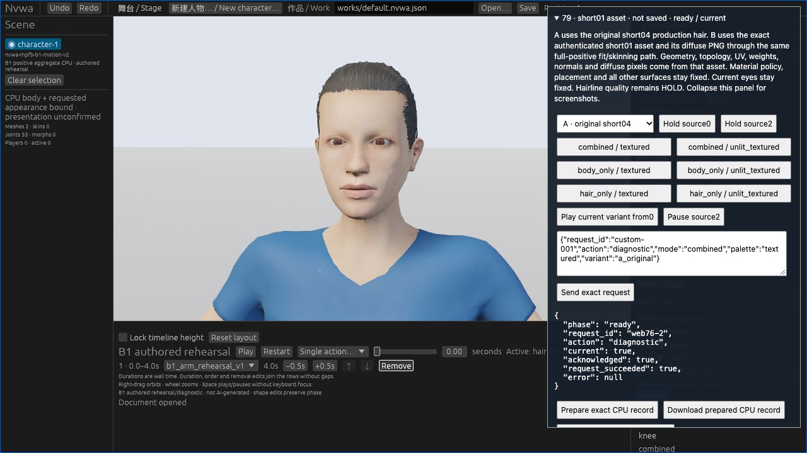
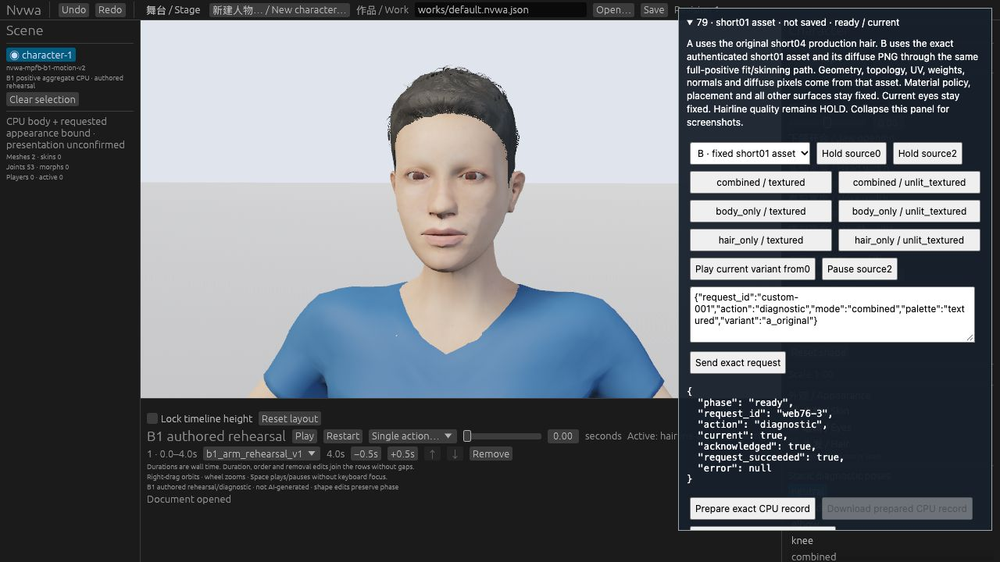

# #79 short01: front pilot PASS, full acceptance pending

2026-10-25. The one independent short01 candidate passes the bounded default-character/source0 Web pilot. Exact A/B/A validation passes. Independent image review finds a clear relative improvement while the forehead and both eyes remain visible. **Retain short01 for bounded wider acceptance. This is not production adoption or completion of #79.**

## Original same-frame images

| A: production short04 | B: independent short01 |
| --- | --- |
|  |  |

These are original unmodified 1280×720 browser JPEGs from the same page, Work, held source0, camera, stage and Combined/Textured mode. The open control panel does not cover the head. A keyboard-focus outline differs outside the head; no pixel-equivalence claim is made.

B has a curved, less uniform front boundary and raised/tousled front volume. The independent reviewer finds these more natural than A's nearly straight, uniformly combed cap edge. Forehead and both eyes remain visible. No obvious new frontal scalp hole, floating mass, severe penetration or face-coverage failure was seen at this view size. B still has a hard/dark boundary and a fine wiry/jagged crown/side silhouette. Hidden contact, side/back fit and final artistic quality remain unknown. No human aesthetic preference was measured.

## Fixed source and behavior

- B is the byte-exact locally retained MakeHuman `short01`, UUID `766436e9-63ed-4f6a-afa9-99f3acff70a8`, `hm08`; four model/material/image files plus original pack metadata and existing CC0 text. [SOURCE.json](SOURCE.json) pins the files. No new model, texture, package, toolchain or dependency acquisition occurred.
- There are 2,984 source points, 3,177 position/UV render corners and 3,678 triangles. Signed mappings, a single 0.1 unit conversion, recomputed normals and all final-positive influences over the current 53 bones use the unchanged geometry path. Four source vertices (76, 202, 434, 952) have five positive influences; the maximum is measured, not imposed as a cap.
- A remains exact original short04. Geometry, scalar replay, Cargo files, original A map and Work fixtures remain byte-equal to experiment89. Controller/protocol/apply/restore mechanics remain unchanged apart from the B identity, map, pins and labels. Material remains `simple-srgb-mask-v1`: sRGB, Mask(0.5), roughness0.7, double-sided/no cull. No alpha, geometry, weights, placement, camera or lighting tuning was performed.
- The legacy litsphere appearance is not reproduced. This preview is an explicitly unsaved experiment; its underlying Work still has the original production appearance identity.

## Actual verification

| Scope | Result | Observed time / bound |
| --- | --- | --- |
| Python controls, corrected normal run | 9 passed | 147.982 s / 240 s |
| Python controls, optimized run | 9 passed | 141.323 s / 240 s |
| Actual Rust publication-called source tests | 5 passed, 0 failed; 20 other tests filtered and NOT-RUN | tests0.16 s; Cargo10m33s; wrapper643.345 s / 20 min |
| Wasm compilation | PASS | Cargo57.13 s; wrapper62.742 s / 10 min |
| Fixed bindgen and staging | PASS; 105 staged files, 97 current assets | 37.150 s |
| Actual same-page Web A/B/A | three ready/current, successful exact exports | default Work, source0, Combined/Textured |
| Frozen existing `validate.py A1 B A2` | PASS | 4.119637 s / 240 s |
| Independent cross-model review | source, native/build chain, raw exports, B source replay, restoration and original images checked | bounded pilot PASS |

Actual B source replay has zero error in uploaded positions, posed normals, UVs, fitted rest and scales; source-normal error is at most `1.1102230246251565e-16`, within the original unchanged assertion. The complete non-asset envelope compares exactly between A and B. A1/A2 restore exactly after only the established request-ID and stable-update-count exclusions. Work, body, eyes, clothing, actual bones, camera, stage and material/image policy remain compared. The actual A2 image also shows original short04 restored.

The user performed only the B selector and Combined/Textured click after browser tool actions failed. Root performed exports, screenshots, validation and A restoration. Native keyboard operations were used for the remaining existing controls. A transient canvas-focus detour did not change the compared camera or Work. No new bridge, chunk mechanism or capture framework was added.

## Preparation failures retained

An initial broad numeric replacement accidentally changed A's MHCLO digest in two new experiment files. Independent source review and the first normal control run caught it. That run failed exit1 after139.707s with `source authentication failed short04.mhclo`; its log and source hashes remain retained. Both A pins were restored before the final45-file freeze, then the affected controls passed. No assertion or failure test was removed or loosened. All actual Rust/Web runs use the reviewed corrected freeze.

An initial local extraction loop also included the archive's thumbnail. That exact task-created copy and its pin were removed before freeze and were not used. The retained source directory contains only the four approved files, pack metadata and CC0 text. These preparation corrections are not geometry/weight fitting attempts or a retuned candidate.

## Reproduction and limits

With the same retained local historical capture, old comparison sources and scalar oracle required by `test_source.py` / `test_isolation.py`:

```sh
python3 -B -m unittest discover -s experiments/91-hair-short01-ab -p 'test_*.py'
python3 -B -O -m unittest discover -s experiments/91-hair-short01-ab -p 'test_*.py'
NVWA91_FIXED_CAPTURE=/absolute/path/to/exact/capture.json \
  cargo test --offline --locked --manifest-path experiments/91-hair-short01-ab/Cargo.toml \
  --lib source_tests -- --nocapture
python3 -B experiments/91-hair-short01-ab/validate.py \
  /absolute/path/to/A1.json /absolute/path/to/B.json /absolute/path/to/A2.json
```

Missing prerequisites must fail explicitly. This is a retained local experiment, not a clean-checkout CI promise. Do not replace the historical fixture with another capture. [EVIDENCE.json](EVIDENCE.json) binds source/build/export identities and retained original images; hashes identify local raw originals rather than replace their contents.

**NOT-RUN:** wider body/head-shape and motion cohorts, side/back fit, between-frame behavior, GPU depth/contact, native UI, genuine CLI short01 persistence, full acceptance, CI and main integration. Copied/compiled Work fixtures do not establish their execution.

Real persistence requires a separate canonical appearance-set identity for the current V2 character and propagation of that selected set through runtime preparation, authenticated loading, cache keys and snapshots. Existing `B1Cc0` / `SetAppearance` and CLI apply/save/inspect/validate surfaces can be reused; the Studio role toggle must preserve the selected set. Merely saving this temporary overlay would still save short04 identity. The read-only feasibility notes are not implementation or acceptance of that change. The existing pilot checker is intentionally default/source0-only; wider acceptance needs its own bounded explicit inputs while retaining this strict pilot path.

**PARTIAL —** The minimal front pilot and exact recovery pass with a relative visible gain. #79 remains open and full quality/adoption pending. M2/#80 HOLD, #112's original failure, #3 blocked and #4 gaps remain unchanged. No production code, root dependencies, gates or old failure evidence changed. No main merge or CI run occurred for this archive.
